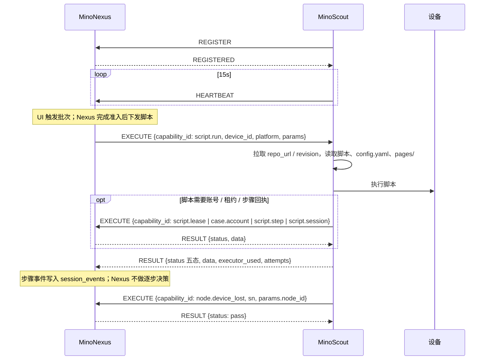

# 协议 — MinoNexus ⇄ MinoScout

> **本文在 MinoNexus 与 MinoScout 两个仓库各有一份，必须逐字相同。**
> 契约真源是两仓同步的本文和两仓 `protocol.py` 实现。改动必须在同一个 PR 周期内完成两仓同步：先改本文，再改两边实现。本地 fixture 仅供调试，不提交 Git。
> 不增加新的信封类型。脚本及记录能力使用本文列出的字段；`record_api_version=1` 显式声明本地记录能力。

用例步骤与框架指令的统一出入口是 `EXECUTE` → `RESULT`。截图、层级、探活、取消 run、节点 stop/restart/update、设备热插拔都是 `capability_id`，走同一套形状。线上只有五种 `type`：`REGISTER` / `REGISTERED` / `HEARTBEAT` / `EXECUTE` / `RESULT`。没有 `OBSERVE` / `PROBE` / `CANCEL_RUN` / `NODE_EVENT` / `NODE_COMMAND`。

加字段时 dumps **省略空值**（`device_id` / `platform` 空字符串、`data` 空 dict）。

---

## 1. 传输与连接

| 项 | 规定 |
|---|---|
| 传输 | WebSocket，文本帧，UTF-8 JSON，一帧一条消息 |
| 方向 | **Scout 主动 dial Nexus**。Scout 永不监听对外端口 |
| 端点 | `ws(s)://<nexus-host>:<port>/node` |
| 单机默认 | `ws://mino.local:50104/node`（开发 `:50101`） |
| 鉴权 | 首帧 `REGISTER` 携带 `token`（配对时由 Nexus 下发）。Nexus 校验失败即关闭连接，close code `1008` |
| 重连 | Scout 侧指数退避（1s → 2s → 4s → … 上限 30s），无限重试 |
| 心跳 | Scout 每 15s 发 `HEARTBEAT`；Nexus 45s 未收到视为节点掉线 |
| 大载荷 | 截图以 base64 放在 JSON 里。单帧上限 32 MiB；超限时 Scout 必须降质重发而不是分片 |

## 2. 消息信封

所有消息共用同一信封：

```json
{
  "v": 2,
  "type": "EXECUTE",
  "msg_id": "01J8ZQ...",
  "reply_to": null,
  "ts": "2026-09-02T15:30:01.123456+08:00",
  "payload": { }
}
```

| 字段 | 类型 | 说明 |
|---|---|---|
| `v` | int | 信封格式编号，收发双方必须一致，不做协商。收到不一致：Nexus 关连接并在 UI 报错；Scout 关连接并退避重连 |
| `type` | str | 见 §3 |
| `msg_id` | str | ULID。发送方生成，全局唯一 |
| `reply_to` | str \| null | 应答类消息填对应请求的 `msg_id` |
| `ts` | str | ISO-8601 带时区 |
| `payload` | object | 各消息自己的载荷 |

**应答规则**：`ACK 必须` 的消息，接收方必须回一条 `reply_to` 指向它的消息；发送方超时未收到则按 §6 重试。

---

## 3. 消息总表

| # | 方向 | `type` | ACK | 说明 |
|---|---|---|---|---|
| 1 | S→N | `REGISTER` | 必须 | 上报身份、能力、挂载设备。应答 `REGISTERED` |
| 2 | N→S | `REGISTERED` | — | `REGISTER` 的应答 |
| 3 | S→N | `HEARTBEAT` | 否 | 保活 + 连通性/设备变化增量 |
| 4 | 双向 | `EXECUTE` | 必须 | 能力或框架指令。N→S：截图 / 点击 / `probe` / `cancel_run` / `node.stop` 等。S→N：`node.device_lost` 等热插拔 |
| 5 | 双向 | `RESULT` | — | `EXECUTE` 的应答，靠 `reply_to` 配对 |

> **协议里没有 `DECIDE` / `STEP_EVENT` / `RUN_FINISH` / `NEED_HUMAN`。**
> 脚本执行与完整记录在 Scout；Nexus 持久保存准入、任务与资源状态和已确认摘要。旧会话接口仅为历史记录兼容。
> 用例主通信只剩 `EXECUTE` ↔ `RESULT`。

---

## 4. 各消息载荷

### 4.1 `REGISTER`（S→N，ACK 必须）

```json
{
  "node_id": "3f8a1c0e9b2d4f71",
  "token": "<pair-token>",
  "platform": "darwin",
  "arch": "arm64",
  "scout_version": "0.1.0",
  "protocol_version": 2,
  "hostname": "mac-studio.local",
  "studio_id": "a1b2c3d4e5f67890",
  "executors": [
    {"id": "adb", "available": true,
     "provides": ["launch_app","close_app","kill_app","press_key","wait_ms",
                  "swipe_direction","swipe_element_to_element","install_apk",
                  "read_device_data","get_app_version","get_foreground_app",
                  "set_clipboard","tap_element","multi_tap","long_press_element",
                  "input_text","exec_script","set_input_method","clear_app_cache",
                  "screenshot","hierarchy","probe_device_state"]},
    {"id": "ios_wda", "available": false, "provides": [], "reason": "no WDA runtime"},
    {"id": "playwright", "available": true,
     "provides": ["tap_element","tap_xy","input_text","press_key","screenshot",
                  "hierarchy","launch_app","close_app","get_foreground_app",
                  "open_url","reload_page","read_web_auth"]}
  ],
  "devices": [
    {"sn": "R5CT30xxxx", "platform": "android", "model": "SM-S9210",
     "channels": {"adb": "connected"}},
    {"sn": "web3f8a1c0e9b2d4f71", "platform": "web", "channels": {"playwright": "connected"}}
  ]
}
```

| 字段 | 规定 |
|---|---|
| `node_id` | 节点稳定标识，**不等于任何 `sn`**。取值 `[a-z0-9]{16}`（Scout 持久化的 `scout_id`），重启后不变。Playwright 槽 `sn` 为 `web` + `node_id` |
| `hostname` | 本机主机名，可空。只作展示 |
| `studio_id` | 写入本机 Scout 配置的工作台 id（`[a-z0-9]{16}`），可空。Nexus 据此记归属 |
| `executors[].id` | 必须是 `adb` / `ios_wda` / `playwright` / `mac` / `win` 之一。另有宿主插件面 `host_plugin`，只声明 `plugin.gmail.fetch_otp`，不操作设备（`remote` 已随 ClawNode 删除；`desktop` 仅作旧载荷入站别名） |
| `executors[].provides` | **具体能力 id 列表**（与 Nexus `catalog_entries` 同一词表，例如 `tap_element`/`clear_app_cache`）。每个渠道用同一套字段声明自己能执行哪些事件，实现可以不同（adb/WDA/playwright/mac/win 各写一份），但字段名与取值域一致，便于跨渠道逐字段对比。旧 Scout 上报的抽象通道名（`ui_native_input`/`system_shell`…）仍按 `requires_caps` 兼容匹配 |
| `account_isolation_version` | 新版 Scout 固定上报 `1`，表示会在收到已认证 owner 后才恢复本地插件；缺失或不支持时 Nexus 拒绝注册（1008），不会消费安装凭证。旧节点需升级后重新连接 |
| `executors[].available` | `false` 时 `provides` 必须为空数组，并给 `reason` |
| `devices[].channels` | 取值：`connected` / `disconnected` / `unauthorized` / `not_applicable` |

Nexus 收到后：`provides` ∩ 能力目录 → 该节点可执行的 capability 集合；`devices[]` 写入设备表并标记 `node_id` 归属。

### 4.2 `REGISTERED`（N→S）

```json
{
  "accepted": true,
  "session_token": "<short-lived>",
  "heartbeat_interval_sec": 15,
  "nexus_version": "0.1.0",
  "protocol_version": 2,
  "warnings": ["device R5CT30xxxx 未在 Nexus 侧登记，已自动创建"],
  "node_id": "3f8a1c0e9b2d4f71",
  "node_token": "<long-lived>",
  "owner_user_id": "<verified-user-id>"
}
```

| 字段 | 说明 |
|---|---|
| `node_id` | 可选。Nexus 重分配 id 时下发；Scout 写入 `config.scout_id` |
| `node_token` | 可选。首次用安装凭证 REGISTER 成功后换发的长期 token；Scout 写入 `config.token` 并替换安装凭证 |
| `owner_user_id` | 认证成功时必填，由 Nexus 凭证/会话解析。Scout 确认本地插件 owner 与服务源一致后才恢复机器人；缺失、冲突或历史未归属配置都停用，不能继承旧凭据 |

安装凭证由登录账号签发，15 分钟有效。首次注册在 SQLite 同一事务内绑定账号和节点、消费凭证并生成独立长期凭证；重复登记仅允许同一节点在有效期内恢复同一长期凭证。不同节点使用已消费凭证、无效/过期/吊销凭证、长期凭证与 node_id 不匹配及跨账号重装必须拒绝。拒绝后关闭连接（1008），不接受任意非空或共享环境 token。`studio_id` 仅兼容，不授予账号权限。

Scout 重装保留 `scout_id` 和已有长期 token，先以 `pending_install_token`、`pending_nexus_url` 尝试本次绑定；成功持久化长期凭证后清理临时字段。明确拒绝时清理临时字段并恢复原账号连接；新机器没有旧凭证则停止等待用户重新生成命令。REGISTERED 增加可选解码字段 `owner_user_id`；新版在线执行要求该值非空。同步更新 golden fixtures。

`accepted: false` 时必须给 `reason`，Scout 记录后按退避重连（不要立刻重试，避免打爆）。

### 4.3 `HEARTBEAT`（S→N，不需 ACK）

```json
{
  "node_id": "3f8a1c0e9b2d4f71",
  "uptime_sec": 3721,
  "busy": true,
  "active_runs": ["run_20260902_153001_R5CT30"],
  "device_delta": [
    {"sn": "R5CT30xxxx", "channels": {"adb": "disconnected"}}
  ],
  "device_workload": [
    {"sn": "R5CT30xxxx", "run_id": "run_20260902_153001_R5CT30", "step_idx": 3, "capability_id": "tap"}
  ],
  "scout_version": "0.1.29",
  "host": {
    "mode": "running",
    "power_source": "ac",
    "charging": "not charging",
    "battery_percent": 80,
    "inhibit": true,
    "cpu_percent": 3.2,
    "rss_mb": 180.0,
    "children": {"Chromium": 1, "caffeinate": 1, "adb": 2}
  },
  "plugins": [
    {"class": "mail", "id": "gmail", "installed": true, "configured": false},
    {"class": "cli", "id": "feishu", "installed": false, "configured": false}
  ]
}
```

`host` 可省略。旧 Scout 不带时，列表功耗格显示「—」。`mode` 为 `running` 或 `asleep`。`power_source` 为 `ac` / `battery`。`charging` 为 `charging` / `not charging` / `charged` / `discharging`。`inhibit` 表示睡眠抑制还在（macOS 上即 `caffeinate` 还活着）。`children` 只数本进程的子进程。

`plugins` 可省略。省略表示这台 Scout 还不认识插件状态，网页显示「需更新后才能配置插件」。每项必有 `class` / `id` / `installed` / `configured`。非密钥明文放在 `values`（如 Gmail `inbox_address`），已写入本机私有凭据文件的字段名放在 `saved_secrets`。密钥值不上报。`class` 为 `cli` / `mcp` / `bot` / `mail`。`REGISTER` 使用同一份列表。


`runtime_capabilities` 可省略。省略表示这台正在运行的进程没有上报输入契约，Nexus 不凭版本号猜测它是否支持当前焦点输入。列表只含执行器实际实现的组合：`id`、`executor`、`platform`、`contract_version`、`supported_combinations`（`target_mode` + `write_modes`）。`REGISTER` 与 `HEARTBEAT` 使用同一份列表；心跳带上它，重启后的新进程才会被当成支持新契约。

`device_delta` 只报**变化**的设备；无变化时可省略。Nexus 据此更新连通性，并在下一次组装菜单时生效。权威设备状态以心跳为准；`EXECUTE node.device_*` 是即时通知。

### 4.4 `EXECUTE`（双向，ACK 必须，幂等）

能力和框架指令的统一出入口。超过 `timeout_sec` 接收方必须停止等待并回 `RESULT status=fail`（见 §6）。

```json
{
  "run_id": "run_20260902_153001_R5CT30",
  "step_idx": 7,
  "sn": "R5CT30xxxx",
  "device_id": "R5CT30xxxx",
  "platform": "android",
  "capability_id": "tap_element",
  "params": {"x": 512, "y": 830},
  "executor_order": ["adb"],
  "low_level": {"command": "TAP", "params": {"x": "{x}", "y": "{y}"}},
  "selected_impl": {"id": "tap.adb", "executor": "adb", "runs_on": "scout"},
  "device_hint": {"adb_serial": "R5CT30xxxx", "password": "***", "ttl_sec": 3600},
  "timeout_sec": 30
}
```

| 字段 | 规定 |
|---|---|
| `capability_id` | 能力或框架指令 id。Scout 不校验它是否存在于目录（目录在 Nexus），只看自己的 executor `supports()` 或内置框架 cap |
| `params` | **坐标一律是 0–1000 归一化千分比，不是像素。** Scout 负责按实际分辨率换算。观察类能力可带 `compress_ratio` 等。点击带 `point_policy`，两条路径不混用。`coordinate`：只用 `x,y`，禁止文案锚点、禁止吸附邻近节点。`node`：只用 `target` 锚点，未命中则失败，禁止用坐标兜底。未带 `point_policy` 时，有 `x,y` 按 `coordinate` 处理，不锚点、不吸附 |
| `device_id` | 可选。设备唯一 ID；空则回退 `sn` / `device_hint`。**dumps 时空字符串省略** |
| `platform` | 可选。`android` \| `ios` \| `web` \| `playwright` \| `other`。空则从 `sn` / `device_hint` 猜测。**dumps 时空字符串省略** |
| `sn` | 设备串号；web/playwright 可为槽位 sn 或字面 `playwright` |
| `executor_order` | **由 Nexus 按这台 `sn` 算好，且必须恰好一个元素。** 该元素必须是服务此设备的通道：android→`adb`，ios→`ios_wda`，web→`playwright`，mac→`mac`，win→`win`；宿主插件操作用 `host_plugin`。`selected_impl.executor` 必须与之一致。`desktop` 只作旧载荷入站别名。**Scout 不 fallback、不改序、不追加通道**；长度不为 1 或类型不符返回 `fail`，不碰设备。空列表视为非法，不按 platform 自动补 |
| `low_level` | 抄自能力目录 YAML 的 `low_level` 段。`{x}` 这类占位符由 Scout 用 `params` 填充 |
| `device_hint` | Nexus 注入的设备凭据，避免 Scout 回查。Web 可含 `headless: true`（Chromium 无头）。**含敏感字段，不得写入 Scout 的日志** |
| `timeout_sec` | 本动作上限。超时回 `fail`，见 §6 |

**幂等**：`(run_id, step_idx)` 是 wire 唯一键，Scout 登记完整 Execute 内容。相同键不同内容拒绝为 `request_key_conflict`；在途重复返回 `request_inflight`。完成后业务/插件动作重复返回缓存结果，不重新执行；允许的只读刷新见 §9。`step_idx=-1` 只表示 Nexus 调用方尚未分配辅助编号，不能直接上线路；首次发送前补独立负编号，同一载荷重发保留编号及完整内容。不同截图、探针、插件消息和 ACK 必须是不同请求，不能因负编号就绕过守卫。

`compress_ratio`（`1.0` = 不压缩）对 **playwright 与 adb** 都生效：按比例缩小后，大于 1 时转 JPEG。Nexus 按渠道填入当前跑用例模型的 `web_compress_ratio` 或 `android_compress_ratio`，Scout 不读设置。**`RESULT` 里的 `width` / `height` 始终报原图尺寸**，坐标体系不受压缩影响。喂给大模型的图另按 `plan_compress_ratio` 统一转 JPEG，与渠道无关。

#### 4.4.1 `capability_id` 清单

| `capability_id` | 方向 | 说明 |
|---|---|---|
| `screenshot` | N→S | 截图。`params.compress_ratio` 对 playwright 与 adb 都生效。Web 的 `params.full_page` 默认 `true`，截取完整文档；显式 `false` 只截当前视口 |
| `hierarchy` | N→S | UI 层级 dump |
| `get_app_version`（别名 `app_version`） | N→S | 目标包版本。回执在原有 `package` / `version_name` / `version_code` 上追加同一份 dumpsys 里的 `install_path` 与 `signing`（见 §4.4.3） |
| `get_foreground_app`（别名 `foreground_app`） | N→S | 前台包名 / bundle id |
| `self_prove` | N→S | 一次取回当前执行环境自证。形状见 §4.4.3。不新增消息类型 |
| `read_device_data` | N→S | 既有单键读取。`key=serial` / `serialno` 读 `ro.serialno`，`key=boot_serial` 读 `ro.boot.serialno`。整份环境自证用 `self_prove`，不要把多次 getprop 当成自证 |
| `probe`（别名 `probe_device`） | N→S | 重探连通性，结果在 `RESULT.data` / `extra.channels` |
| `cancel_run` | N→S | 不再继续该 run，不回滚已发到设备的动作 |
| `node.stop`（别名 `stop`） | N→S | 应答 RESULT 后 Scout 退出 |
| `node.sleep` | N→S | 不退出。放开睡眠抑制并关掉 Chromium，心跳继续，`host.mode=asleep` |
| `node.wake` | N→S | 节点仍连接时重新抑制睡眠。不在这一步开浏览器 |
| `node.restart`（别名 `restart`） | N→S | 应答后自拉起再退出 |
| `node.update`（别名 `update`） | N→S | 无远程装包路径则 `fail` |
| `node.log_tail` | N→S | 读本机 Scout 日志 tail。`params.lines` 默认 200，上限 2000 |
| `node.device_lost` | S→N | 设备消失。`params.node_id` / `detail` / `severity`；`sn`/`device_id` 为设备 |
| `node.device_found` | S→N | 设备出现 |
| `node.channel_changed` | S→N | 通道状态变化 |
| `node.engine_crashed` | S→N | WDA / u2 agent 等崩溃 |
| `node.shutting_down` | S→N | 人主动停。Nexus 立刻失败该节点在途 run。Scout 会在这条之前再发一帧 HEARTBEAT |
| `node.update_progress` | S→N | 远程/本机自更新进度。`params.progress`：`stage` / `label` / `percent` / `layer` / `bytes_*` |
| `node.plugin_install` | N→S | 按发布清单安装一个 CLI / MCP。`params.class` + `params.id`。不接受临时 URL |
| `node.plugin_remove` | N→S | 卸掉该插件目录，并删掉它在本机私有凭据文件里的密钥 |
| `node.plugin_config` | N→S | 写入该插件参数。密钥只留在 Scout 本机私有凭据文件，应答里不回显 |
| `node.plugin_progress` | S→N | 插件安装进度。形状同 `node.update_progress`，另带 `class` / `id`，不写入自更新的 `update_job` |
| `plugin.gmail.fetch_otp` | N→S | 用这台节点自己的 Gmail 应用专用密码取验证码。参数只有 To、时间、发件人过滤和轮询预算，没有密码 |
| `plugin.cli.feishu` | N→S | 用这台节点的飞书应用凭证读文档。参数是 `action=read_doc` 和 `url`，没有 `app_secret`。另支持 auth_start/auth_status/auth_cancel：由节点运行官方 CLI config init --new 及 auth login --recommend，返回 state/summary/authorization_url（仅官方 HTTPS 授权页）；凭据不出节点。start 复用进行中的授权，status 不创建应用，cancel 仅停止当前授权子进程。重启返回 interrupted；继续时复用已保存应用。扫码授权和手动应用凭据均可读取文档 |
| `plugin.cli.meego` | N→S | 用这台节点的 Meego 插件凭证换票或查工作项。参数没有 `plugin_secret` |
| `plugin.bot.send` | N→S | 飞书机器人或企业微信 webhook 发文本。`kind` 为 `feishu_bot` / `wecom`，没有 webhook |
| `tap_element` 等 | N→S | 仍走 executor；Nexus 给该 sn 的 `executor_order`，Scout 按 sn 执行 |

`node.stop` / `node.restart`：Scout core 在 RESULT 的内部 extra 里打标记，transport 回完 RESULT 后再 shutdown。**不能靠 `node.stop` 或 `node.wake` 启动一台已经离线的专机。** `node.sleep` 不打退出标记。

S→N 的框架事件可丢（超时未等到 RESULT 时 Scout 只记 warn）；权威状态以 `HEARTBEAT.device_delta` 为准。

#### 4.4.2 `hierarchy` 的 RESULT 形状（NavFSM 依赖，两仓钉死）

`hierarchy` 是**结构化**的，不是一坨文本。`RESULT.data["nodes"]` 是节点数组，
`RESULT.extra["nodes"]` 是同一份数据的镜像（Scout 侧 `_result_from_event` 同时填两处），
接收方读任一即可，**不要**假设只有其中一个存在。

```json
{
  "status": "pass",
  "summary": "UI 层级 128 节点",
  "executor_used": "adb",
  "data": {
    "source": "adb",
    "elapsed_ms": 41,
    "nodes": [
      {
        "resource_id": "com.example.app:id/tab_feed",
        "text": "Tab A",
        "content_desc": "",
        "class": "android.widget.TextView",
        "clickable": true,
        "bounds": [0, 1848, 270, 1968],
        "center": [135, 1908]
      }
    ]
  },
  "extra": {"nodes": [/* 同上 */]}
}
```

| 字段 | 规定 |
|---|---|
| `hierarchy_format` | **`accessibility_json`**。这是本协议唯一的 hierarchy 形态；`flat_text` / `xml_dump` 不是协议形态，只能是接收方自己派生的展示文本 |
| `nodes[].resource_id` | 完整 id，含被测应用包名前缀（`{package}:id/...`）。可能为空串 |
| `nodes[].text` / `content_desc` | 可见文本 / 无障碍描述。可能为空串 |
| `nodes[].class` | 控件类名全称 |
| `nodes[].clickable` | 布尔 |
| `nodes[].bounds` | `[left, top, right, bottom]` |
| `nodes[].center` | `[x, y]` |
| `data.source` | 采集**通道** id，当前恒为 `adb`（与 `executor_used` 同值）。Scout 内部的 dump 来源（u2 / exec-out / 落盘）只进 Scout 日志，不上协议 |
| `data.elapsed_ms` | 本次 dump 耗时 |

> **坐标体系警告**：`bounds` / `center` 是**设备像素**，与 §4.4 里 `params` 的 **0–1000 千分比**
> **不是同一个体系**。拿 hierarchy 的坐标直接塞进 `tap_element.params` 会点偏。要换算的一方自己按
> `RESULT.width` / `height`（截图报的原图尺寸）折算。

**通道限制与失败语义**：

| 场景 | 行为 |
|---|---|
| web / playwright 槽 | `status=pass`，`data.source=playwright`，`nodes` 为 **DOM 快照**（`input`/`button` 等，`class` 为 HTML tag 或 `tag:type`）；**不是**安卓 `android.widget.*` |
| 非 adb 序列号 | `status=fail`；iOS 走 WDA hierarchy，Web 走 DOM 快照，桌面走 AX/UIA |
| dump 失败（设备忙 / agent 挂） | `status=fail`，`error` 汇总各来源的失败原因 |

`hierarchy` 是观察类能力，每次新观察使用独立 `step_idx< -1`；同请求的重取仍经过完整请求守卫。Scout 侧有 1.5s 的 TTL dump 缓存，
动作执行后会主动失效；调用方要最新一帧就跟在动作之后取。

Nexus 侧收到 `fail` 时**不得**让本次运行失败：按导航图谱（本仓 `docs/专题/导航图谱.md`，Scout 仓对应设计在 `docs/ARCHITECTURE.md`）的层级降级策略处理
（`hierarchy_text` 置空、localize 退回 session + history、GuardGate 本 turn 不 block）。

#### 4.4.3 `self_prove` 的 RESULT 形状（用例自证，两仓钉死）

用例脚本用这一条能力核对「现在这台手机 / 这台 Mac 上的 Scout，跑的是哪一个包」。它不建立第二套设备清单：Android 复用 `get_app_version` 的 `dumpsys package`、`read_device_data` 的 `getprop`，以及 `pm path` 指向的已安装 APK；iOS 复用同一份字段，证据来自已有的 `ideviceinfo` / `ideviceinstaller`（在 PATH 上时）和 `device_hint` 里已经给出的 WDA 地址。

`RESULT.data` 与 `RESULT.extra` 都带这份文档（与 hierarchy 一样两处镜像）。传输层仍可能往 `extra` 追加 `execution_identity`；脚本读 **`data`**。`data.schema` 必须是 `self_prove.v1`。

调用仍走普通设备动作的选路规则：`executor_order` 只有一个元素，`selected_impl.executor` 与它相同。

| 通道 | `executor_order` | `platform` | 设备地址 |
|---|---|---|---|
| adb | `["adb"]` | `android` | `device_hint.adb_serial`（缺省时用 `sn`） |
| ios_wda | `["ios_wda"]` | `ios` 或省略 | `device_hint.udid`，没有则用 `sn` |

`platform=ios` 只允许出现在这条能力、且执行器为 `ios_wda` 时。它不是目标平台集合的新成员；其它能力仍只接受 `mac` / `win` / `android` / `web`。`ios_wda` 配上 `android` / `mac` / `win` / `web` 拒绝为 `self_prove_platform_conflict`。

`params.package` 可选。Android 是包名，iOS 是 bundle id。给出之后才会去读安装身份；不给出则只证明设备和节点，`missing` 里不出现 `app.*`。

```json
{
  "status": "pass",
  "summary": "self_prove android R5CT30xxxx com.example.app sha256=0123456789ab",
  "executor_used": "adb",
  "data": {
    "schema": "self_prove.v1",
    "device": {
      "id": "R5CT30xxxx",
      "serial": "R5CT30xxxx",
      "reported_serial": "R5CT30xxxx",
      "udid": "",
      "platform": "android",
      "model": "SM-S9210",
      "name": "",
      "os_version": "14",
      "id_source": "ro.serialno",
      "ids_agree": true,
      "hint_id": "R5CT30xxxx",
      "hint_match": true
    },
    "app": {
      "package_id": "com.example.app",
      "installed": true,
      "version_name": "1.2.3",
      "version_code": 120,
      "install_path": "/data/app/~~xx==/com.example.app-yy==/base.apk",
      "digest": {
        "sha256": "0123456789abcdef0123456789abcdef0123456789abcdef0123456789abcdef",
        "md5": "0123456789abcdef0123456789abcdef",
        "source": "installed_base_apk",
        "path": "/data/app/~~xx==/com.example.app-yy==/base.apk",
        "reason": ""
      },
      "signing": {
        "apk_signing_version": 3,
        "cert_sha256": "",
        "source": ""
      },
      "splits": []
    },
    "runtime": {
      "scout_version": "0.1.29",
      "node_id": "3f8a1c0e9b2d4f71",
      "build_id": "dev-0123456789abcdef01234567",
      "identity_kind": "source",
      "source_unchanged": true
    },
    "drivers": {
      "adb": {"serial": "R5CT30xxxx", "server_port": null},
      "wda": {"url": "", "port": null, "reachable": null, "version": "", "udid": "", "error": ""},
      "appium": {"url": "http://127.0.0.1:4723", "port": 4723}
    },
    "missing": ["app.signing.cert_sha256"]
  }
}
```

| 字段 | 规定 |
|---|---|
| `device.id` | 设备自己报出来的标识。Android 优先 `ro.serialno`，否则 `ro.boot.serialno`，都没有则用这次实际拨到的 adb serial。iOS 优先 `ideviceinfo -k UniqueDeviceID`，否则用 WDA `/wda/device/info` 的 uuid。没有读到设备应答时为空，此时 `status=fail` |
| `device.serial` | 这次 adb 拨号用的 serial。iOS 为空串 |
| `device.reported_serial` | Android `getprop` 读到的 serial。没有第二来源时为空串 |
| `device.udid` | iOS 读到的 UDID。Android 为空串 |
| `device.platform` | 证明所属家族：`android` 或 `ios`。不是把 `ios` 写进目标平台枚举 |
| `device.id_source` | `ro.serialno` / `ro.boot.serialno` / `adb_serial` / `ideviceinfo` / `wda` / 空串 |
| `device.ids_agree` | 两个及以上设备侧标识都存在时，是否完全相同。只有一个来源时为 `null` |
| `device.hint_id` | 调用方传入的 serial 或 udid。不是设备应答 |
| `device.hint_match` | 设备应答与 `hint_id` 是否一致。设备没有报出可比较的标识时为 `null`。换机后这里应为 `false`，或根本 `fail`（旧 serial / udid 已不应答） |
| `app.installed` | 未请求包时为 `null`。请求了且确认安装为 `true`，确认未安装为 `false` |
| `app.digest` | Android：已安装 APK 字节的 sha256 与 md5，优先 `base.apk`（`source=installed_base_apk`）。这是手机上的安装路径，不是安装前宿主机 APK 的 `apk_sha256`。读不到文件时 digest 为空，`reason` 说明（常见 `unreadable` / `not_installed` / `pm_path_empty`）。iOS 不宣称安装包字节摘要，`reason=ios_bundle_bytes_not_readable` |
| `app.signing` | 只解析本次 dumpsys 里已经出现的 `apkSigningVersion`、`certDigest` / `SHA-256 digest`，或 `signatures:[...]` 里完整证书 DER 的 sha256。没有这些文本则 `cert_sha256` 为空，不额外拉取 apksigner |
| `app.splits` | 除主 APK 外、最多再哈希 7 个 split。主 APK 不重复列入 |
| `runtime.scout_version` | 本进程已加载的 Scout 版本，与 REGISTER / HEARTBEAT 的 `scout_version` 同一来源 |
| `runtime.node_id` | 本进程 Scout 节点 id |
| `runtime.build_id` | 与 `execution_identity.build.build_id` 同一进程身份。源码进程在磁盘已变时 `source_unchanged=false` |
| `drivers.adb.server_port` | 仅当进程环境变量 `ANDROID_ADB_SERVER_PORT` 有合法端口时填写。未设置则为 `null`，不把默认 5037 写成已观测事实 |
| `drivers.wda` / `drivers.appium` | 只回显 `device_hint.wda_url` / `wda_port` / `appium_url` / `appium_port`。URL 必须是带显式端口的 `http` 或 `https`，不能带账号、query、fragment。Android 不拨这些地址。iOS 只对通过校验的 WDA URL 请求固定路径 `/wda/device/info` 与 `/status`，不扫端口，不调用 Appium |
| `missing` | 字典序。设备 id、Scout 版本、节点 id 为空时列入。只有请求了 `params.package` 才列入 `app.package_id`、`app.installed`、`app.digest.sha256`、`app.digest.md5`、`app.signing.cert_sha256` |

`status=pass` 表示设备应答了，标识已写入 `device.id`。包摘要或签名缺失仍是 `pass`，差距在 `missing` 和 `digest.reason`；脚本自己决定这算不算换错了包。`status=fail` 表示 serial / udid / WDA 都没有让设备应答。`executor_used` 为 `adb` 或 `ios_wda`。

`get_app_version` 不改为计算摘要（避免每次查版本都哈希安装包）。它只把同一份 dumpsys 里的 `install_path` 与 `signing` 附加进原回执。包字节摘要只在 `self_prove`。

同一 `(run_id, step_idx)` 的重复请求仍返回缓存，不重新读设备。要换机后再证，使用新的 `step_idx`。

### 4.5 `RESULT`（双向）

所有 `EXECUTE` 共用应答类型，靠 `reply_to` 区分。

```json
{
  "run_id": "run_20260902_153001_R5CT30",
  "step_idx": 7,
  "status": "pass",
  "summary": "TAP (512,830) -> ok",
  "error": "",
  "executor_used": "adb",
  "source": "adb",
  "elapsed_ms": 412,
  "attempts": [
    {"executor": "adb", "status": "pass", "elapsed_ms": 412}
  ],
  "image_base64": "",
  "image_mime": "",
  "width": 0,
  "height": 0,
  "extra": {},
  "data": {}
}
```

| 字段 | 规定 |
|---|---|
| `status` | **五态之一（小写）**：`pass` / `fail` / `skipped` / `blocked` / `declined`。取值与上游 `EventStatus` 逐字一致。Router 的处置见 §4.5.1。超时用 `fail` |
| `executor_used` | 实际执行的 executor id。**不可省略**，Nexus 的 trace 与覆盖度依赖它 |
| `attempts` | fallback 链的逐次记录。全部失败时 `status` 取最后一次的结果 |
| `image_*` / `width` / `height` | 截图时填；也同时放进 `data` |
| `data` | 任意返回参数（截图、层级 nodes、probe channels、能力原始结果）。**空 dict 时 dumps 省略** |
| `error` | 失败原因，面向人。**不得包含 `device_hint` 里的凭据** |

Scout **任何情况下不得让异常逃出** —— 内部异常一律转成 `status: "fail"` + `error`。Nexus 收到 S→N 的框架 `EXECUTE` 后必须回 `RESULT`，不能让 Scout 干等。

Scout→Nexus 的 `RESULT.extra.execution_identity` 是可选的执行证据 v1，由传输层覆盖填写：
`{schema_version:1,node_id,scout_process_generation,node_connection_generation,build:{build_id,source_commit,dirty,identity_kind,source_unchanged,source_digest?}}`。
代际必须与本次派发所属的已认证连接一致，不从磁盘新版本或当前重连节点补造历史身份。发布包沿用进程启动时的 BUILD.json；源码进程使用启动时包内源码摘要产生 `dev-<摘要前24位>`，并检查源码是否已变化。`source_unchanged=false` 时该回执不能证明所测 build，需要重启并重新执行。该摘要只标识源码快照，不代表发布包的文件摘要。

Nexus 在 `session/provenance` 固化实例/build，并将实际结果中的 `scout.execution_identity`、派发时 `scout.nexus_identity` 写入普通与严格 Web 会话。旧节点无字段时明确证据不足；REGISTER、版本字符串或准备操作成功不能代替实际执行回执。本扩展只增加既有 extra 字段，不改消息结构，不宣称正式 Web 闭环或 MCP 全工具回归通过。

#### 4.5.1 五态与 Router 处置

取值与上游 `server/services/ai/regression/schemas.py::EventStatus` 逐字一致（**小写**，且是 `pass` 而不是 `OK`），避免搬迁时到处翻译名字。

| status | Router 行为 | 语义 |
|---|---|---|
| `pass` | 立即返回 | 做成了 |
| `blocked` | **立即返回** | 需要人介入 —— 换 executor 没有意义 |
| `declined` | 试下一个 executor | 主动让位，**不算故障**（日志 info，不计失败） |
| `fail` | 试下一个 executor | 真故障，但仍兜底换通道再试一次 |
| `skipped` | 试下一个 executor | 本次未执行（前置不满足等） |

**只读或有写前 no 回执时，`declined` 与 `fail` 才允许走 fallback**，区别在**是否算故障**，不在"换个 executor 有没有用"。只有 `blocked` 会中断 fallback 链。

`skipped` 是 executor 也会返回的值（上游 executors 里出现 6 次），不是 Nexus 独有的编排态。

---

## 5. 时序



---

## 6. 超时、重试、幂等

| 场景 | 规定 |
|---|---|
| Nexus 等 `RESULT` 超时 | 用 `payload.timeout_sec` + 5s 宽限。正编号请求不重发；负编号只读可按同一键重发一次。UI 写无回执记结果未知并隔离，不使用新键重放 |
| Scout 执行超过 `timeout_sec` | 立刻回 `RESULT status=fail`，`error` 说明超时。实现是 `fut.result(timeout=timeout_sec)`：**Python 线程无法强杀**，底层 adb / 设备动作可能仍在跑 |
| Scout 收到重复 `(run_id, step_idx)` | 先比较完整内容；冲突/在途明确拒绝，已完成业务或插件动作返回缓存 `RESULT`，**不重新执行**。允许的只读刷新见 §9 |
| 连接断开 | Scout 退避重连并重发 `REGISTER`。在途 `EXECUTE` 的结果若已产生，重连后 Nexus 重发同键请求即可取到缓存 |
| Nexus 重启 | Scout 的 `REGISTER` 会重建节点登记。在途 run 由 Nexus 侧判为中断，不尝试续跑 |
| S→N 框架 `EXECUTE` / `HEARTBEAT` 丢失 | 允许。状态最终由下一次 `HEARTBEAT` 收敛 |

**Scout 侧不做业务重试。** `executor_order` 必须恰好一个元素；任何状态（`pass` / `fail` / `blocked` / `declined` / `skipped`）都结束本次尝试，由 Nexus 重新决定是否再发。同一 executor 内的机械重试（如 adb 偶发 `device offline`）允许，但必须记进 `attempts`。

---

## 7. 兼容性

- **加字段**：允许，接收方必须忽略不认识的字段
- **加消息类型**：允许，接收方对未知 `type` 记 warn 并忽略（不可关连接）
- **改字段语义 / 删字段 / 改 `type` 名**：不允许，必须 `v` 加一
- 双方在 `REGISTER` / `REGISTERED` 交换 `protocol_version`，不一致时**低版本方拒绝连接并明确报错**，不做降级协商

---

## 8. 本地 fixture 校验

本地调试时可用 `tests/fixtures/protocol/` 校验协议实现，两仓若有样例应保持一致；这些文件不纳入 Git。

```
fixtures_sha256 = 0be21298b045a908bb1a829cdb12413035724416327ff26eea33812a2ffebfa5
```

有本地样例时，两仓各自确认：① `protocol.py` 能 round-trip 全部 fixture；② fixture 目录哈希与上面记录一致。

哈希算法：按 JSON 文件名字典序拼接每份 `文件名 UTF-8 + 换行 + 原始文件字节`，再取 SHA-256。


## 9. 桌面通道补充契约

新字段均可缺省，不按 Scout 版本猜桌面能力。旧设备 fixture 不增加空字段。

- `REGISTER.host` 与 `HEARTBEAT.host` 由 Scout 上报实际 OS/arch/hostname 与 `desktop` 探测状态。持久化在 SQLite `nodes.extra`。
- `DeviceManifest` 增加 `os`（macos/windows/linux）、持久逻辑槽 `session_key`、临时 `session_generation`、`desktop_state`、`blocked_reason`、可空 `capabilities` 和 `readiness`。持久化在 SQLite `m_device.extra`，设备平台为 `mac` / `win`。
- 原生设备 SN 为 `mac:<node_id>:console` / `win:<node_id>:console`。一个节点只能上报自己的槽及实际宿主 OS；窗口和显示器不生成设备。无 GUI/锁屏/缺权限/缺插件保留逻辑槽且通道为 disconnected，不表示可执行。
- `HEARTBEAT.executors` 必须是完整快照，且 `executor_snapshot_version=1`；不接受缺失或增量。Desktop 状态更新必须保留同帧其他执行器。
- `device_delta` 比较完整 manifest；会话代次、能力或权限变化也必须发送。Nexus 替换完整设备状态，不能只合并 channels。
- `EXECUTE.device_hint` 带 `os/session_key/session_generation/desktop_lease/target_package`。任务创建时冻结代次，Desktop 输入必须持有当前任务的 SQLite 独占租约。Scout 重启或 Cua readiness 状态变化使旧代次失效，不能用新心跳给旧任务续代次；系统会话及窗口的实际输入准入由 SDK 最终校验。
- 原生设备只路由 `mac` / `win` executor。未知平台显式拒绝，不落回 ADB 或 Playwright。截图 capture_id、OS session_generation、SDK snapshot_id 与报告截图 hash 是不同身份。
- SDK 连接在一个桌面 worker 中持续复用。每次动作尝试消费最近一次截图引用，捕获绑定点击使用 Cua capture_id；超时视为结果未知，停止该 runtime 后续操作，不能自动换通道再输入。取消阻止新动作，不回滚已发生的输入。
- Desktop 使用其独占的 `desktop:<node_id>:console` 锁。Web SN 不区分 headed/headless，也不区分 run/debug/script/v5；同一 Web SN 的所有执行共用一张 lane 池。SQLite 事务同时建立设备租约和任务，终态释放租约。
- Native macOS/Windows 采用 Cua Driver 0.34.1，按锁定 SDK wheel API 对齐；会话、权限与平台 readiness 消费 Cua health_report，窗口捕获和输入准入由 Cua 校验，Linux 暂不开放执行。Windows fixtures 覆盖就绪、锁屏与 Session 0；真实硬件验收与二进制发布另行记录，不将契约验证当作实机通过。Cua perception 不在此切片。
- `RESULT.extra` 保留精简动作证据 `cua_action`（effect/route/delivery/error.code/escalation），不保存输入正文或 SDK 原始 JSON。Nexus 在 `tool/result` 追加可信派单元信息 `scout`、`attempts` 和 `desktop`；未涉及任务的进程启动/注册/重连日志仍仅在 Scout 本地日志中。

### 桌面输入与执行证据

不改变消息 envelope 或 fixture 字段。Desktop `input_contract` 按 executor 上报 `current_focus` + `replace` / `append`，Nexus 不复用 Android 的 ADB 输入准入规则。点击使用服务端注入的、绑定 run_id 与事件 seq 的 focus_ref；Scout 保存窗口与字段落点，在新窗口捕获中经 Cua 重新定位字段，再执行窗口输入，引用不能跨代际或任务复用。不再使用项目原生焦点探针。

OBSERVE 的 screenshot 与 RESULT 的执行诊断通过 capture_id、session_generation 对齐。Nexus 的 Session Log 主动作和恢复子动作记录实际 executor、节点、尝试链、桌面 effect/route 与 evidence.kind；不复制原生证据自由文本详情。截图引用来自 Scout，网页所属系统不能替代节点上报的宿主 OS。

### 桌面窗口托管

消息 envelope 和 protocol dataclass 不变；以下元数据经既有 screenshot `remote_detail` 与 RESULT `extra` 传输。

- Nexus 在 PC 首张截图前派发 `launch_app`，Scout 用 Cua 启动应用、确认目标 pid 并绑定 `target={kind:window,pid,window_id}`；macOS 和 Windows 均不在启动阶段调用 bring_to_front 或要求持续前台。`launch_app.params.window_id` 或 `device_hint.window_id` 可明确选窗；目标窗口不存在或不可唯一选择时 blocked。每个 run 保存独立绑定，取消、超时与代际变化清理绑定。
- 桌面 `close_app` / `kill_app`：Scout 将 `kill_app` 归一为 `close_app`，经 Cua `terminate_app` 结束与 `package` / `target_package` 匹配的前台进程并清理窗口绑定；目标未在前台时 completed 并说明未命中，不强制先截图。
- 截图使用 SDK 通用 `get_window_state`，指定 pid/window_id，关闭 AX 树并注册动作捕获（display_only=false）。typed WindowStateOutput 未暴露 capture_id，因此不能拿 snapshot_id 冒充捕获引用。不调用整屏截图，也不在窗口截图失败后改截桌面。
- screenshot 元数据含 capture_scope=window、target、pid/window_id、snapshot_id、capture_id、session_generation、capture_width/capture_height、native_width/native_height、window_bounds、screenshot_scale、compress_ratio。capture 尺寸始终对应返回给模型的最终图像。PC 压缩默认 1，较大压缩比通过 Cua 原尺寸校准后设置 max_image_dimension；项目不再自行缩图。
- 点击使用 ActionTarget.WINDOW 与 ClickPosition.CAPTURED_COORDINATES，Cua 原子校验捕获、所有者、窗口几何与有效期，处理 Retina/压缩映射并消费捕获。输入和按键也绑定窗口，显式 delivery_mode=foreground；项目不向整个桌面投递坐标或键盘事件。
- 前台状态读取使用 Cua list_apps.active，仅作为真实全局前台诊断；窗口准备只确认进程与窗口绑定，不消费 bring_to_front 的激活回执，不以全局前台归属作为截图准入条件。Nexus 的全局前台自动恢复不用于 Desktop。launch 成功元数据为 stage=window_ready、window_verified=true、foreground_source=not_required、activated=false、foreground_verified=false；这些前台字段表示未请求或验证持续激活。截图必须取得 SDK 的有效窗口捕获；点击与输入仍由 Cua foreground 模式在动作时处理投递准入，不能由 launch 成功推定动作成功。健康、权限和会话诊断使用 health_report，不读取项目自研平台探针。generation 跟随 Scout 生命周期及 Cua readiness 状态变化；窗口与捕获是否仍可动作由 SDK 最终校验。
- tool/call 在窗口准备派发前写入；tool/result.desktop 保留窗口 target/capture_scope、捕获身份和安全动作证据，observe/screen 保留 pid/window_id、图像尺寸及缩放信息，便于核对是否确实为指定窗口。


## 10. Web 写安全与证据

新增容量字段可缺省。严格 Web 写安全是显式选择的执行模式，不能根据 Scout 版本号、旧 agent 字段或连接形态猜测支持。未报契约、未发布配置或模式不符时拒绝；legacy 路径保持独立。

### 10.1 准入、定位与写动作

- `probe` 的 `RESULT.data.contracts` 必须包含 `web_v5=1`、`locator_contract=web.locator.v1`、`predicate_facts_contract=web.atomic.v1`。`device_hint.execution_mode=v5`，设备固定为该节点的 `web{node_id}`，platform 为 web/playwright。不能改派开发节点或另一节点。
- 控件从发布快照提供 `control_id/revision/locator_spec/sensitive`。`locator_spec.playwright` 只支持 `contract=web.locator.v1`、`scope={kind:page,page_id:main}`、`selector`、`cardinality=one|set`。selector 只允许 test_id、精确 role/name、精确 label、受限 css；首期不支持 iframe、shadow、隐式 dialog、XPath、text 猜测、first/nth。
- `tap_target` 和 `input_target` 只接受 one，必须真实唯一、可见；每条请求只有一次 click 或 fill 入口，不做 type、快捷键、坐标或 VLM 回退。集合 set 只供事实读取。能力目录由 Nexus 显式配置并冻结 `selected_impl`，Scout 不读取目录。
- `open_web_v5` 每个 run 新建独立 headless browser/context。Nexus 在写动作前读取业务配置的未登录基线；新 context 本身不代表基线已满足。

### 10.2 wire 身份与门闩

- `(run_id,step_idx)` 是 wire 身份，logical seq 只是显示关联。正编号由 Nexus 按 run 加锁、单调分配；辅助负编号由 Nexus 全进程原子递减分配并以启动微秒分代，不消耗任何 run 的正写编号。`-1` 为待分配哨兵。现有任务 run_id 保持原值；无任务 RPC 的 run_id 仍为空，不伪造活动任务。插件/主机命令也可使用辅助编号，负编号本身不代表只读。不同意图绝不复用键；同请求重取必须保持整个 Execute 内容一致。
- Scout 原子登记完整请求。相同键但内容不同返回 `request_key_conflict`，相同键正在执行返回 `request_inflight`；完成重复请求只返回已有结果。完整内容只在内存比较，不能为了幂等将密码等秘密做 hash 后输出。
- 负编号只读请求可以刷新事实；正请求缓存不能以等待超时冒充真实完成。legacy Future 超时冻结并缓存已返回的未知结论，worker 仍活动的事实单独保留，迟到结果不能覆盖。
- 正编号 EXECUTE 不做网络重发。丢 RESULT、超时或写后异常归为 effect_unknown，不能再点击同一动作补绿。允许的恢复是：用例已声明可复位且发布重试策略，开全新 run 整案重跑最多一次，后通过标 flaky，原尝试保留 unverified。
- `data.execution={execution_started:no|yes|unknown,phase,reason_code}` 表示写 API 的实际进入边界，不由错误字符串反推。写前拒绝为 no；已进入写 API 后异常为 yes/effect_unknown；无法确定为 unknown。
- 写故障锁住 run 的第一个停止原因。`data.execution_control` 带 `stop_run/state/reason_code/action_ref`；后续写返回 `run_write_stopped`，只读和清理可继续。close/cancel 置 terminal，迟到成功不能解除停止或翻绿。
- 设备故障返回 fail 及上述领域原因；不将所有驱动异常标成需要人介入的 blocked，也不进入 legacy executor fallback。

### 10.3 原始事实与秘密

`data.target_facts` 只提供原始事实，不提供“用例通过”。包含 control_id/control_revision、scope_resolved、collection_complete、count、可读取的 visible/text/value、fact_complete。`data.observation` 提供 run_id、session_generation、after_step_idx；只有动作真正完成才推进 after_step_idx。Nexus 校验这些来源与当前 run、已发布控件及动作关联，再运行 required 原子谓词。读失败、过期来源、截断值或不完整 scope 不能按不存在或匹配成功处理。

敏感控件及真实 password 输入不返回明文 value/text；只允许 secret_value.nonempty/length。长度不代表密码正确，不支持秘密明文 expected 比较。截图遮罩发布敏感控件及真实 password 控件，日志/摘要/模型上下文递归脱敏；执行所需明文仅进入执行通道，不写入证据或请求诊断。

### 10.4 容量与回收

`HEARTBEAT.device_workload[]` 在 Web 设备行可带 `lanes_total/lanes_free/lanes_quarantined`，Nexus 以实际报告为准。资源本质上是按设备占用：Android/iOS/desktop 为单占；每个 Web SN 只有一张 `web:<sn>` lane 表。run、debug、script、v5、headed、headless 只是执行标签，不创建第二套容量，每个执行独占一 lane 与相应工作线程，满时排队或拒绝。默认容量为 8，可用 `MINO_WEB_PLAYWRIGHT_LANES` 配置为 1..64；8 是保守默认值，不是未经压测的硬件极限。心跳除容量行外，还会为每个活跃 lane 上报 `run_id` 与 `web.lane.<kind>`，供 Nexus 对本地预约和 Scout 实占去重。超时终止 worker 和浏览器后代，未确认全部停止的 lane 隔离；close 与 dispatch 竞争时，不能在请求锁释放前宣称 lane 空闲。`close_web_strict/cancel_run` 返回 executor_stopped，未回收成功不能宣称干净结束。

### 10.5 终结

Nexus 将 Evidence、verification/verdict、session_meta、计数在一个 SQLite 事务终结，以 finalization_id 支持重复提交而不重复执行 UI。超时后允许独立短清理及落库窗口，不能给 UI 或 LLM 续预算。截图是证据附件，不能替代动作后原始事实。事实/required 不满足返回 verified_fail 或 unverified，绝不因为工具 pass 或未报错显示绿色。

### 辅助请求发送闸门（2026-10-14，cr-72f483f92cdf）

Nexus 的 `NodeConnection.request` 在序列化 EXECUTE 前统一补齐未编号辅助请求；插件调用在建立载荷时使用同一 helper，RouterProxy 取证、插件和结束通知使用同一负编号分配器。重复发送同一载荷不重新编号；传入的正编号、任务归属、focus_ref 与动作证据引用不变。严格 Web 缺 run_id 必须拒绝，不能补伪造任务。

辅助取证的新请求使用独立编号，不靠复用 `-1` 绕过完整内容比对。Scout 现有 `read_web_target_facts/screenshot/probe` 在同内容完成后的只读刷新规则不变；新增观察的身份与重取的身份必须分清。不能为消除冲突关闭 Scout RequestGuard。


## DOM 优先观察

任务策略 `action_scheme` 接受 `dom_preferred` / `visual`；旧任务的 `dom` 归一为 `dom_preferred`。策略不等于能力目录实现类别；目录 `schemes` 继续是 `dom` / `visual`。每个 EXECUTE 的实际定位方式由 `params.point_policy=node|coordinate` 声明，一条写请求只能选一种方式。

Web hierarchy 的 `RESULT.extra.observation`（在 Scout 内部 EventResult 上为 `raw_response.observation`）可包含 `version=1`、`snapshot_id`、`source`、`scope=viewport|visible_tree`、`truncated`、`missing`、`node_count`、`node_limit`。这是可选字段；旧节点没有该合同仍可提供旧层级。当前视口不等于完整文档，不得据截断观察断言全页面不存在。

节点可包含 `node_ref`、`snapshot_id`、`role`、`enabled`、`visible`、`checkable`、`checked`、`checked_known`、`selected`、`focused`、`value`、`frame_path`、`cross_origin`。密码不回传 value/text。节点引用只在产生它的运行浏览器页面及当前采集中有效，不能跨任务、页面或重新采集复用。Scout 持有真实 DOM handle 并检查连接、可见性和可操作性；跨源 frame 缺口明确标出，不能把其占位节点当可点击目标。

DOM 点击可携带 `params.node_ref` 与 `params.snapshot_id`，Nexus 绑定本轮唯一节点后下发，Scout 校验引用失效就 blocked，不按其他文本或坐标重试。`RESULT.extra.execution_started=true`（Scout 内部 `raw_response` 的同名字段）表示动作可能已写入；失败或超时也不得换 executor 或视觉重放，必须先观察确认结果。视觉兜底只发生在尚未派发的定位/观察阶段，使用同轮截图。每个动作仍截图留证；结构有效的模型请求不附图。

Android 的层级请求在 Scout 强制重新采集，先筛选可见且有语义的节点再限制到 320 个；enabled/focused/checkable/checked/editable 与 password 标记从真实 XML 属性解析。密码字段文本不回传。原生树暂不发行 Web DOM handle 引用，继续使用既有节点锚点，不伪造 ref。


## 普通执行写边界与停止语义

普通 UI 写结果复用 `data.execution={execution_started:no|yes|unknown,phase,reason_code}`。旧执行器的显式布尔回执由接收入口适配；缺失/异常为 unknown，不能由 fail/declined/skipped 推定为 no。只有能证明未进入写 API 的 no 允许后备实现；yes/unknown 失败立即停止 fallback，返回 blocked 表示结果未核验，不等于需要人工输入。pass 只表示执行器已返回，不替代业务断言。

普通 Future 超时只停止等待，不能宣称线程或设备动作已终止。缓存首个超时结论，同键重发不重做，迟到结果不得翻成 pass；相同 run 的后续写被锁住。cancel 仅请求不再继续；worker 仍活动时不能回收页面/桌面资源。`stop_confirmed=false` 与 `resource_isolated=true` 分别表示停止尚未确认和需保留隔离，不用任务终态推导两者。

Nexus 普通任务在已有 run payload 记录不含动态输入/秘密的写意图，派发前持久化；回执缺失、写后异常或回执无法落库时保留 pending/isolated。设备预约、设备×包租约和账号租约不得因任务终态、TTL、重启清扫或旧投影覆盖而释放；隔离记录不参与常规历史裁剪。本阶段不提供自动解除隔离，需 N2 后续的受控停止证据合同；不冒称已经获得严格绑定、原子终结或底层强杀能力。


### 心跳 executor 快照

两端 HEARTBEAT 的 `executor_snapshot_version` 必须显式为整数 `1`，`executors` 必须提供完整数组：`[]` 撤销全部；非空数组完整替换当前连接清单，不能按 id 合入。dataclass 缺省 `0` 仅用于识别缺字段并拒绝，不是有效协议值。缺失/null、bool 或未知版本拒绝心跳。`available=false` 不参与准入。

`0` 或缺省只用于已安装旧 Scout 的兼容增量，维持按 id 合入；其空数组不能证明撤销完成，不提供新绑定保证。必须按显式字段判断，不能凭 Scout 包版本猜测。新 Scout 上报全量 executor，再覆盖其中原生通道的实时就绪事实，不发送原生-only 列表。设备 channel=connected 不能重新放行已撤销或 unavailable 的 executor。

协议包版本沿用现有版本，以这个可选字段显式区分更新语义；旧载荷解码为 0。新增字段两仓同步，合法/缺省/空数组载荷须各自 round-trip。本切片没有新增 binding_id/进程代际的 Execute 校验，不能据此声称完整 ExecutionBinding wire 合同已完成。


### 原生动作的显式完成回执

`execution.execution_started` 仍为 yes/no/unknown。Router 不得从任意 executor 的 status=pass 推断 yes；缺失即 unknown，即使 pass 也必须停止后备、保留资源隔离，不能让消费端收到合成的安全回执。已核实的原生动作在实际设备调用成功的完成出口写显式 yes 和 source（adb.native.v1 / playwright.native.v1）；本地等待/纯取证写 no。yes 是设备执行边界事实，不证明业务预期已满足。失败或未适配实现没有边界事实时仍 unknown，不为了维持成功率默认为 no 或 yes。普通/严格原有更强检查保留；迟到结果不覆盖已冻结未知结论。


### 执行绑定代际载荷

以下字段均可缺省；缺省仍为旧执行合同，不能凭 Scout 包版本推断支持。

| 消息 | 新增字段 | 缺省/来源 |
| --- | --- | --- |
| REGISTER | scout_process_generation、capability_revision、execution_binding_version | 空串/空串/0；进程代际由 Scout 每次真实解释器启动生成，声明能力时显式报绑定版本 1 |
| REGISTERED | node_connection_generation | 空串；Nexus 每次成功注册生成，不复用旧连接 |
| HEARTBEAT | 上述三个 Scout 字段、node_connection_generation | 空串/空串/0/空串；ACK 后回传当前连接身份 |
| EXECUTE | execution_contract_version、binding_id、binding_revision、operation_ref、node_connection_generation、scout_process_generation、capability_revision、input_contract_version | 空串/空串/0/空串/空串/空串/空串/0；仅显式 execution_binding.v1 启用绑定校验 |

capability_revision 是完整 executor 声明（id/available/provides）与 runtime_capabilities 的规范化快照身份；两仓使用同一 stdlib 算法。更新元数据与快照同锁生效。执行器全量/增量规则保持原合同：snapshot_version=1 时 None 不更新、[] 撤销全部；旧版本 0 保留兼容增量。不一致快照不能宣称 binding ready。旧连接心跳不能改写替换后的会话；进程代际变化需重新注册，不能只发心跳换身份。

新合同绑定精确单个 executor、selected_impl、low_level、runs_on=scout 及 params_contract/result_contract={version:1}，漏装配拒绝，不做后备选路。参数适配器版本 1 与原生 input_text 合同版本 2 是不同维度；input_text 还需 EXECUTE.input_contract_version=2，并精确符合当前 runtime 的 target_mode/write_mode/platform 组合，不能把独立支持集合做笛卡尔积。bool 不能当整数版本。

Scout 在请求准入、队列后的执行入口，以及严格 Web 取得 lane 和发送 worker IPC 前分别复核代际。校验拒绝返回 blocked、execution_started=no；不得因拒绝释放既有未知写隔离。尚未使用的新 lane 可回收，已启动或隔离的 worker 仍走原停止/回收合同。本切片仅实现 wire 和副作用前复核，不会自动把所有现合同任务切到新绑定合同；旧安装 Scout 继续报告绑定版本 0。


### low_level 实际调用回执与恢复停止

原生分支以外的声明式 shell/shell_seq/shell_batch 同样必须提供 execution 回执。执行前模板/白名单拒绝以及本地明确找不到 adb 二进制为 no；实际 shell 完成提供 yes（来源 adb.low_level.v1）；超时、远端非零、调用异常无法证明没有副作用，保持 unknown。先前已执行后发生声明/解析失败不能回退成 no。known read 的最佳努力部分取证仍允许，write 的 shell_batch 只有所有项成功才算完成。聚合 pass 不生成调用边界；回执来自实际 shell 调用出口。

恢复规则收到 resource_isolated 或 execution_control.stop_run 时必须立即结束本规则，不再执行解锁、后续恢复动作或下一轮 verify。停止信息贯通 RecoveryOutcome、屏幕守护、本地屏幕就绪工具及 agent 的 blocked 终结；新截图可读不能冲掉未结算写动作。内存停止信号仅用于停止循环，不能释放任何持久未知写隔离；任务终态、版本升级、重启均不是解除依据。


### 接续合同

write_stop_status 是仅在任务结束后由 Nexus 显式复核的管理请求，参数 action_ref 与 scout_process_generation 必须来自原写意图。Scout 返回 stop_evidence(contract=write_stop.v1、action_ref、sn、进程代际、stop_confirmed)。同代际、同设备、同动作的实际 worker 已返回且有明确 no 或成功 yes 回执、该旧 run 无活动请求才确认；封存旧 run 禁止后续业务写。未知回执、缺历史身份或进程更换继续隔离。确认只表示执行结束，不证明业务成功或账号状态干净；原 verdict 不改，后续任务仍须做账号/页面基线检查。

Nexus POST /case-runner/tasks/{task_id}/write-safety/recheck 校验任务所有者、任务已结束、在线节点所有者与代际，重新读取持久动作后保存复核证据。终态、升级、TTL、重启不能代替证据。无证据的旧隔离不提供强制清除入口。停止证明只写入账本，不提前清空 `device_app_sessions.lease_run_id`，也不释放号池。解除隔离走 POST /case-runner/tasks/{task_id}/write-safety/baseline：当前画面截到之后，同一次提交放开这些设备的写隔离、设备会话、执行资源、设备租约、预约，以及任务 / 动作 / 用例会话 id 上的号池租约。不能先放设备再单独放号。非 Web 执行资源键仍是 `device:<sn>`，Web 槽位仍是 `device:<sn>:<run_id>`。

**旧进程退役证据（2026-10-15 补充）**：原写意图的进程代际与当前不同或缺失时，Nexus 发送 write_stop_status 并带 params.mode=retired_generation、scout_process_generation=原值（缺失为空串）。Scout 若在本进程仍持有该 action_ref 的请求记录，按同进程规则返回 mode=same_process、action_present=true；否则封存该 run 并返回 mode=retired_generation、action_present=false、single_instance_lock（本进程持有 scout.lock）、process_started_at（本进程启动 epoch 秒）、foreign_processes（安装目录下非本进程树的运行时进程，以及指定 sn 的 adb 客户端进程数；无法判定为 -1）。仅 single_instance_lock=true、foreign_processes=0 时 stop_confirmed=true，reason_code=predecessor_retired。Nexus 接受条件：证据为当前在线代际；原代际存在且不同，或原代际缺失且 process_started_at 晚于任务 finished_at 至少 120 秒；缺代际的同进程证据仅在 action_present=true 时接受。复核记录 recovery.mode。该证据只证明执行进程及其运行时子进程已不在，写入结果仍为 unknown，原 verdict 不改。源码运行（非安装包）无法判定运行时目录，保持隔离。

**严格 v5 与解除后基线（2026-10-15 补充，2026-10-29 收口）**：execution_mode=v5 的任务可复核。Nexus 在 write_stop_status 参数带 execution_mode；Scout 同进程证据在 action_present 且 worker_active=false 时关闭该 attempt 的 lane，并在 lane 进程树确认终止后返回 lane_terminated=true、reason_code=lane_process_terminated，否则为 lane_quarantined。Nexus 对 v5 同进程证据要求 lane_terminated=true；旧进程退役证据规则不变。停止复核只登记停止，不把动作标成 recovered，也不清设备会话。`write-safety/baseline` 在当前画面可用之后，同一次提交把对应设备上的动作记为 recovered，并把 sn × 被测包的 device_app_sessions 置为 session=unknown、stale=1、stale_reason=write_recovered_unknown、lease_run_id 为空，同时释放这些设备的执行资源、设备租约、预约，以及任务 / 动作 / 用例会话 id 上的号池租约。截图失败则一段都不放。原 verdict 不改。人工观察恢复仍可用，并释放同一别名集合上的号池租约，不要求执行资源 detail 里已经写了 account_id。

含 not_visible 的检查在新发布计划固化 single_observation.v1/max_reads=1；复合谓词同一次取证，其他谓词默认等待不变。旧冻结否定计划拒绝并要求重新发布，不静默更改历史。Scout 在读取事实前确认 document.readyState=complete，回传 page_ready 和 observation_contract；Nexus 缺此证据不可判不存在。这只证明页面文档就绪，业务异步加载是否结束仍须由用例已有前置/检查点保证，不声称检测了持续不出现。


## 平台合同

新增纯校验模块 `platform_contract.py`（Nexus/Scout 同步副本，Workbench 为同语义 TypeScript）：被测平台严格四值 mac/win/android/web；集合显式 all/explicit，未填写与空集合不同；宿主单独 host.os；server 是渠道 kind，不携带 platform；顶层与 device_hint 冲突拒绝；不从 SN 猜 Android、不接收运行别名。常量 version=1 是目标合同版本，不是已协商/已启用声明。本切片未改变 REGISTER/HEARTBEAT/EXECUTE wire 字段或默认运行行为，旧协议仍在使用。

Nexus 节点列表新增只读 `platform_contract_audit`：mode=shadow、activated=false、target_version、observed_device_count、issues、migration_required。仅报告平台字段问题计数，不输出参数、凭据或原始 manifest；不能将 issues 为空解释为完成数据迁移或具备新绑定执行能力。

资源准入支持规范 mac/win SN。Desktop 继续使用 `desktop:<node_id>:console` 独占资源锁；Web 使用 `web:<sn>` 的单一 lane 池，headed/headless 以及 run/debug/script/v5 不生成第二套容量。新 SN 与 node_id 不一致拒绝。此兼容基础不自动迁移设备，不释放已有隔离。

原子切换仍依赖 N1/N2 与受控数据迁移。不能提前宣称新词表已全局生效；Scout 注册与输入能力、Nexus 运行消费者及 Workbench 写入口将在整体切换切片同步调整。

## 固定装配与绑定关联

ExecutionBinding v1 的 Scout 候选须按当前 manifest 逐个验证：事件本身出现在 provides，或 selected_impl.requires_caps 中全部抽象能力均已提供。Nexus 与 Scout 使用同一规则；available=false、撤销、连接/进程/能力代际变化均使旧绑定不能继续派发。不新增协议 dataclass 字段，不放宽缺装配写前拒绝。

runs_on=nexus 只由 Nexus 已知本地适配器产生，不发送给 Scout；其子动作必须各自使用提交绑定中的操作引用。普通设备请求、结果与框架观察记录绑定 ID/operation_ref 和代际；本地结果记录绑定关联。实际 EXECUTE 投影包含完整低层装配与精确输入组合；输入参数最终盖章后再核对，不能借目标/写入模式变化绕过合同。

普通 attempt 在业务 UI 操作前提交绑定事务；失败不进入循环，也不通过外层清理新建无绑定 close_app。完成时在绑定内清理，再原子写会话终结；外层仅发送管理性取消通知。未知写的隔离与停止确认仍遵循既有 I02 合同。动态插件执行没有 v1 装配时拒绝，不复用普通设备绑定越权派发。


### 原生平台消费路径

新增 mac/win 原生身份的消费支持，不切换默认 Scout manifest，不宣称平台合同已协商或启用。目标平台 mac/win 与历史 executor/channel=desktop 是不同字段；共享资源键仍为 desktop:<node_id>:console。旧 desktop 接收路径作为切换期兼容保留，不能用兼容路径证明全量迁移完成。

规范原生设备必须使用 <platform>:<node_id>:console，session_key=console，平台与宿主系统一致；不得携带设备 os。Nexus 登记检查会拒绝使用 mac:/win: 保留前缀伪装为其他平台的上报。规范原生 EXECUTE 顶层平台与 device_hint.platform 必须一致，device_hint 不带 os/native_os/device_platform/target_platform，SN 与本节点、宿主系统和会话槽一致。Scout 在动作解析之前拒绝不一致请求，写前拒绝带 execution_started=no。窗口会话代际、权限、桌面租约及驱动最终准入仍继续执行，不以平台检查替代。

Nexus 的路由家族、动态能力目录、观察/恢复分支、输入合同与设备准入识别 mac/win；Scout 的 DeviceRef、截图路径和原生 executor 同步识别，不能落到 ADB/Playwright。新原生用例匹配只接受明确四值或合法 coverage；Mobile/pc/desktop/缺失平台不会被解释成任意平台，Web 用例不会自动改写为原生用例。

下一步仍需同步切换 Scout host/device/runtime_capabilities 上报、协议激活/旧节点拒绝边界和历史引用迁移。当前通过的是隔离消费路径检查，未执行真实原生操作、未迁移业务数据。


### 平台合同默认启用

本节取代影子阶段的默认上报约定。REGISTER/REGISTERED/HEARTBEAT 新增 platform_contract_version（缺省 0）；Scout 发 1，Nexus 接受后明确回 1。缺失、bool 或其他版本拒绝，不凭包版本推断。REGISTER.platform 保留空串以兼容 dataclass 构造；宿主只由 host.os=mac/win/linux 声明。设备只允许 mac/win/android/web，原生 SN 为 <platform>:<node_id>:console，不带 os；Linux 不注册原生桌面槽。executor/channel 使用 `mac` / `win`；资源锁键仍沿用历史 `desktop:<node_id>:console`。

注册与心跳在修改可用能力前验证全部设备身份及 runtime_capabilities，包括递归 platform/platforms/platform_scope、重复或冲突覆盖、深度/数量上限、executor 与目标平台对应关系、input_text 合同版本 2 及 target_mode/write_modes 精确组合。无效注册拒绝；无效心跳关闭连接，不部分接受。host.os 变化要求重新注册。空 runtime_capabilities 是显式撤销，None 为缺合同而拒绝。新连接不继承旧 desktop 活跃槽；历史记录、未知写隔离和共用资源锁不改写。

用户已取消历史 SN 迁移，选择清空后重新导入；清空范围尚待明确，因此本切换不删除业务配置或历史数据。新合同只接受规范输入，旧配置须重新导入或在正式入口修正。源码启用不等于真机/业务验收通过，运行版本和 session 证据另记统一开发记录。


### 平台实机回执

REGISTER 的空 platform 必须保留在编码中，保证旧必需 dataclass 字段可回读；系统身份仍仅使用 host.os。DesktopRuntime 在实际 SDK 调用成功返回后给出 execution={execution_started:yes,phase:completed,source:desktop.cua.v1}；复用已确认运行窗口而没有再次启动为 no，异常/超时不补造 yes/no。hierarchy 属于只读取证，原生不支持时的拒绝不触发写停止或资源隔离。取消内部请求带明确空 sn；取消不等于回滚。

探索限制和 case_scene 必须随任务快照保留，支持 max_steps=1 的单次观察；这是观察路由验收，不提供普通/严格业务绑定保证，也不改变业务单次弹窗断言语义。实际业务验收仍需对应编译/发布与 session 证据。


### Web 取消与超时

取消尚未租到 lane 的 run 也必须唤醒排队等待者。租到 lane 后及发送 worker IPC 前重新核对取消状态；取消与 IPC 发送按同一条件锁排序，明确写前拒绝为 no。发送开始后发生异常不能声称未执行，保留 unknown 并清理所属 worker；外层超时同样封闭本 attempt。清理释放 lane 不等于允许相同 run_id 重新执行，超时/取消的 run 继续拒绝后续请求。取消后迟到响应不作为 pass 返回。请求锁或进程树未释放时，不宣布 lane 空闲。未变更 wire 字段或放宽旧绑定准入。


### 同节点 Gmail 取码绑定

`plugin.gmail.fetch_otp` 是具名只读宿主插件操作；绑定运行使用 executor `host_plugin`，不得借用设备 executor 或空 executor_order 降级。Scout 在插件账号归属核验后才声明 `host_plugin` 可用，provides 精确为该能力；插件 configured 状态单独上报并由 Nexus 按同一 owner、node_id 和连接/进程代际检查。其他 plugin 能力不因此取得绑定执行资格。

Nexus 在编译需求中有界展开 get_otp 的 Gmail 子事件，固定码分支无需该子事件。动态 Gmail 来源需同时满足目录 active、版本 1 参数/结果合同、同节点 manifest 和插件 configured，才能计为 ready。实际取码前从已持久化 binding 重新核对 phase、operation_ref、binding_id 及三个 epoch；EXECUTE 携带已有 execution_binding.v1 的全部字段，executor_order=["host_plugin"]、selected_impl.runs_on="scout"、low_level={}。Scout 校验后才交给现有 Gmail 处理器，回执 executor_used="host_plugin"。参数不携带密码；未配置、合同不支持、节点或代际变化均保持阻断。ready 仅代表可发起取码，不代表已取到验证码或登录成功。


## Gmail 动态取码

- 不新增 wire 字段。`get_otp` 仅可展开固定程序子事件 `plugin.gmail.fetch_otp`，阶段 prep/do，caller=program；两者独立进入持久绑定，子操作不进模型菜单。不开放通用插件动态递归。固定验证码路径不要求邮箱插件。
- Scout 注册执行器 `host_plugin`，提供 `plugin.gmail.fetch_otp`；绑定实现为 `program.v1:plugin.gmail.fetch_otp`，参数与结果合同版本均为 1。仅已上报该实现的节点可接受绑定取码，旧包明确需要升级。继续校验连接代际、进程代际、能力版本、运行及阶段。
- Nexus 只在当前执行账号拥有的实际目标节点上检查 Gmail 配置。邮箱凭据留在 Scout；请求仅携带租用账号的准确收件地址、真实发码时间、过滤条件及有界预算。发码时间或截止时间缺失时拒绝；不从模型参数或其他账号补值。
- 取码只读取邮箱，使用只读 INBOX 和 BODY.PEEK；收件地址完整匹配，缺失/过期邮件时间拒绝。轮询和网络读取受截止时间及停止检查约束。取消、失效代际或截止时间之后的码不再交付；Nexus 不自动重发绑定取码请求。
- 返回验证码仅供既有凭据消费和脱敏管线，摘要不含验证码、邮箱密码、邮件正文或服务端原始异常。超时区分未收到邮件、过滤不匹配、正文未匹配验证码；失败不转为成功。


### 条件必需观察扩展

沿用 hierarchy observation v1，可选新增 form_controls：version=1、snapshot_id、credential_forms、checkable_count、complete。仅当前结构事实，不含凭据或业务结论。complete 要求唯一包含凭据字段和提交控件的原生 HTML form 完整位于视口、文档就绪且没有截断、观察缺口或不透明自定义渲染；checkable_count 覆盖文档中的 checkbox/radio/switch。缺字段、原生树或不完整范围不能据此证明不存在。

Nexus 在当前新鲜快照的完整范围内 count=0 时记录条件 not_applicable，不计通过证据。已勾/未勾需明确 checked_known；未知最多三次观察后阻断。条件适用且缺实现不得跳过。该扩展不改变 OBSERVE/wire 结构，不授予调用权限。


### 视觉复核与邮箱连接恢复

hierarchy observation v1 可选增加 viewport_wh（CSS 像素）及 login_scope v1（snapshot_id、candidate_count、bounds、complete、checkable_count）。唯一可见 form/dialog 必须包含输入及按钮、范围及其可见内容完整位于视口、无滚动裁切/遮挡/不透明子树，才可 complete。此事实仅为候选范围，不等同登录或无协议。Nexus 另以当前截图确认登录目的、完整可见范围及没有交互协议控件；只有结构 count=0 与视觉证据同时成立才可 not_applicable。未知仍最多三次观察后阻断。Web 显式自绘勾选目标使用视觉状态复核，动作仍按原绑定、当前 node_ref 仅执行一次并核验新状态。ARIA 缺 checked 不再默认为 false。

Gmail 在原请求/收件地址/发码窗口/截止时间内允许最多两次只读重连，未恢复就失败；不重新发码、不重放父子绑定请求。瞬时 DNS、连接超时/断连/拒绝/网络不可达可恢复；认证、协议、TLS/证书及未知错误立即失败。错误码区分以上类别及读取超时。otp_diagnostics 仅携带 connection_attempts/reconnects/error_code/phase，不含原始异常、账号或验证码。取消及截止时间继续约束所有读取及退避。

补充：login_scope 支持含凭据输入的最外层有界自定义容器（不依赖 form/ARIA）；scope_kind、incomplete_reasons 仅为结构诊断。多个范围、滚动/越界/遮挡/不透明内容仍拒绝。SVG defs/clipPath/mask/pattern/symbol 非绘制定义不计可见范围；非滚动装饰的内在溢出不等于表单裁切，实际绘制边界及可滚动内容仍核对。自定义范围必须经截图独立确认完整登录界面及无协议控件，不能只按 DOM 零计数跳过。


## 开发准备

保持现有 wire 版本与 EXECUTE/RESULT 结构。新增程序系统能力 `node.ide_prepare`，
REGISTER/HEARTBEAT runtime_capabilities 声明 id、executor=ide、contract_version=1。
旧 Scout 无该声明时 Nexus 返回 unsupported，禁止按版本号猜支持。
请求 run_id 为空、step_idx 为辅助负编号，不冒充用例 run；executor_order=[ide]，
selected_impl 显式携带 runs_on=scout 和 params/result_contract.version=1。
params 必含稳定 operation_id、action；动作 check/execute/stop/restart/build/probe 接收已授权的 binding：
connection_id/revision、project_path、source_dir、配置名、测试目标及执行许可。
save_connection/list_connections 仅通过有项目维护及节点归属权限的 HTTP 入口，连接存 Scout JSON。
RESULT.extra.development 返回 state、reason、检查结果或 receipt（source/output/truncated/timedOut/exitCode）。
失败结果可选 reason_code、remediation、error_field（project_path/source_dir/connection_id），用于显示原因、处理办法和定位字段；不改变 wire 版本。阶段 matching_project 表示 IDE 已连通，正在核对指定项目。
IDE 项目不再受源码目录黑名单或 development_ide_projects 样例名单限制，仍校验目录存在及源码位于项目内。执行许可、明确项目路由、进程身份及互斥规则保留。
有副作用操作的 IDE HTTP 无回执记 unknown，不自动重发；只读连接检查的超时或网络失败记 failed 并给出修正办法。有 timedOut=true 的回执继续就绪探测；非零 exitCode 失败。
Scout 持久最小幂等回执，重复 operation_id 参数不符拒绝；Nexus SQLite 持久完整业务记录。
node.ide_prepare 不进入 UI 动作 fallback。执行与重启互斥于节点设备操作，同机 IDE 跨 Scout 文件锁。
check 可返回 runtime 和 support.inspect_running/restart/restart_reason。runtime 包含 state、scope=project、configuration_verified、observed_at、instances（pid/name/created_at）及 reason；当前进程检测仅证明项目归属，不宣称配置名已匹配。execute 先按当前 MCP 所属 PyCharm、同用户、项目目录和进程父链读取已有实例；单一实例返回 reused_existing=true 并验证，多实例、端口冲突或无法确认时不重复启动。
probe 有健康地址时验证 HTTP；未配置地址时只检查项目进程，结果可含 process_running，不将进程运行写成 target_ready=true。检测到运行实例即返回 reused_existing=true，无需另做激活；execute 的已有实例检查先于 IDE 配置调用，复用路径不调用启动工具，只有确认未运行才走启动流程。HTTP 检查为可选验证，不以缺少健康地址或无法证明配置名阻断单实例复用。Workbench 显示已复用、检查时间、请求期间加载及完成反馈，不把重复 probe 命名为“使用”操作。配置检查与运行就绪分开：Workbench 从当前绑定的 checked_revision、项目匹配、有效配置名和已保存权限恢复阶段；配置完成展示详情与三个已完成步骤，节点离线或应用停止不清除配置完成状态。
开发联动按实际工具能力选择控制方式，不再依赖 Mino 自写 IDE 插件。普通 Run 使用社区 MCP Run Control（Lewik/mcp-run-control），通过 PyCharm 原生 MCP 暴露 list_running_run_configurations / stop_run_configuration，启动使用同一原生连接的 execute_run_configuration。Debugger MCP Server（hechtcarmel/jetbrains-debugger-mcp-plugin）继续提供调试会话控制，单独连接成功不代表能控制普通 Run。
若当前选择 Debugger MCP，Scout 只从已保存连接中寻找同一用户、同一 PyCharm 进程拥有的原生 MCP，并核对真实 tools/schema；不扫描猜测端口，不覆盖用户连接。控制回执固化所用连接 ID/revision，恢复时不得静默改用其他连接。
Client 依据真实 schema 适配 project_path/projectPath。普通 Run 列表可能跨项目返回，Scout 必须按 canonical projectPath 与 configurationName 精确匹配，再以 sessionId、configurationName、stopAllMatches=false 停止单个会话；不使用窗口焦点或仅按名称跨项目停止。保留 Debugger MCP 的明确项目、配置名和 session_id 适配。
check 返回真实 support.stop/restart 和 restart_mode=run_control_mcp/debugger_mcp/run_control_required/unsupported_configuration；普通 Run 控制不受 canDebug 限制。仅调试插件就绪但实例为普通 Run 时必须返回 restart=false，不能先宣称支持再要求用户手工停止。缺能力返回 awaiting_developer/ide_run_control_required，提示安装社区插件及复用已保存原生连接，不下载 Mino 自写 ZIP。
新增 action=stop；Scout features 显式声明 stop/debugger_mcp/run_control_mcp，Nexus 对旧 Scout 拒绝 stop。停止、重启与启动使用同一执行权限、配置 revision、参数确认及互斥规则。
配置级 runtime.scope=configuration，instances 可携带 session_id、debug_state、execution_mode、pid。普通 Run 以 IDE 返回的配置会话识别，调试模式匹配 runConfigurationName。停止后不将列表中隐藏 terminating 会话视为进程已退出；核对旧进程身份或完整项目会话/进程快照实际减少，再启动同一配置并确认新 session_id。普通 Run 无需先手工停止或改为 Debug；已运行时 execute 只复用，不重复启动。
副作用调用只发一次；超时或丢回执记 unknown，Scout 持久原操作阶段、旧会话及进程标识。读取原回执仅做会话状态查询，不重新停止或启动。Nexus 中断恢复后自动读取原停止/重启回执，核对 owner 与 digest，不清空不确定结果。未配置 HTTP 地址只证明进程/会话存在，不宣称服务或业务验证通过。不得通过终端 kill/SIGTERM 冒充 IDE 重启。HTTP/SSE 复用现有 httpx，无新增运行依赖。

APK 增补：action=install 只接受绑定中的 apk_path/android_serial/apk_package/apk_version_code。
Nexus 创建和派发时复核设备属于同一活 Scout；Scout 要求源目录内的本地 APK，固定副本后以
Android SDK aapt2 验证包名/versionCode。安装使用 -r -t，不降级、不卸载、不清数据；成功后
回读设备包版本。构建由独立 build 操作显式触发，未改代码无需重复构建。没有设备/SDK不宣称完成。

日志增补：action=logs 只读取绑定中的 service_log_path，真实路径必须位于 source_dir 内。
仅返回文件末尾最多 32768 字节，receipt.source=configured_service_log，包含 output、
truncated、byte_offset；输出经过秘密脱敏。不提供任意路径读取或持续日志订阅。


## Scout 更新合同

不变更 wire 版本或 EXECUTE/RESULT dataclass。runtime_capabilities 新增
node.update / executor=core / contract_version=1 / platform_scope=all / platforms=[]。
缺声明的节点明确 unsupported，不能转旧的 latest 更新命令。

EXECUTE 使用空 run_id、step_idx=-1、sn=""、executor_order=[core]、low_level={}，
selected_impl 明确 runs_on=scout 及 params/result_contract.version=1。
params.action=update|rollback|status；update/rollback 带 operation_id、release_tag、build_id，
rollback 另带 rollback_of。tag 定位已配置 GitHub 仓库发布，build_id 核对包身份；二者不混用。
不接受远程任意 URL。RESULT.extra.update 返回同一 operation_id 和执行端持久状态。

Nexus scout_updates 表持久保存 operation/参数/等待截止/门禁和最后确认回执。
等待时不设置 draining；新批次在资源准入同一 BEGIN IMMEDIATE 中检查门禁。
不支持排队的入口返回409 blocked_by_update、operation_id 与请求 task_id；没有创建任务。
已准入批次继续，RouterProxy 每次发送核对冻结 device_targets/allowed_node_ids。
准备操作同门禁，已运行和未确认 IDE 操作阻止安装；未派发排队项不算活动项。
默认等待1800秒；取消/过期只释放本操作，派发后不按等待期限强杀。
派发记录先落库；重启及重注册后查询原操作，结果未知不重复安装。

Scout 在同一锁内核对设备/IDE 活动及隔离 lane，再封闭本地新操作。
独立助手使用保留 runtime/app，等待原 PID+create_time 退出，持有运行锁后安装。
固定 schema1 清单的 component/build/source_commit、平台、包大小、sha256、层指纹及
app requires_runtime/requires_browser 必须通过；只接受声明已验证 rollback_build_ids 的组合。
暂存树替换后保留 previous-bin，配置/凭据不参与替换。未知或中断保留 needs_operator。
运行确认使用进程启动时捕获的 BUILD，通过已连接 Scout 的 status 回执完成；磁盘版本不算成功。
新版启动失败先协作停止，确认退出后回退保留旧层；失败不得强杀或删除维护记录。
CLI update-recover <operation_id> 仅恢复原旧层，不重下或重放安装；助手锁防并发恢复。
update-status <operation_id> 只读，不能自行宣布在线核验通过。

源码交付不代表各平台安装验收通过。真实 clean release、兼容性演练及目标平台运行证据另记。


## 结果恢复与连接扩展

保持现有 wire 与开发准备 contract_version=1。Scout features 增加 receipt；Nexus 先检查声明。
action=receipt 携带新 operation_id、target_operation_id 与原参数的 SHA256 target_digest；
只读取节点持久回执，不重放原 EXECUTE。持久回执包含实际 stage/stages，最终落盘前 fsync。
POST development/operations/{id}/recover 与 MCP development.recover 复核账号、应用与节点归属；
可恢复已确认的最终结果并释放节点占用，保留 previous_state/时间/source；无回执仍保持未知。
节点断线和 Nexus 重启不重发已派发操作；过期排队项失败、在途项转 unknown。新业务任务的
资源准入与开发占用在同一 SQLite 事务检查；其他节点及只读操作不被慢 IDE 调用串行阻塞。

connection.transport 显式选择 streamable-http 或 sse，不自动回退、重连或重发。
SSE 服务提供的 POST 端点必须同源，事件与 HTTP 响应均有上限/截止时间。
headers 仍仅接受非秘密 x-idea-project；认证使用 header_env 对象：
{"Authorization":"MINO_IDE_AUTHORIZATION"} 或 {"X-API-Key":"MINO_IDE_API_KEY"}。
值只能是 MINO_IDE_ 开头的本机环境变量名称。Scout 本机解析、缺失则拒绝；密钥值不经过
Workbench/Nexus，也不写连接 JSON 或回执。Authorization 环境变量包含完整 header 值。
旧的明文 token/header 导入仍明确拒绝。返回连接摘要仅包含 authentication 和 auth_env_names。

Windows 提供跨进程互斥与经过 PID/创建时间/用户/cwd/IDE 父链核验后的 WM_CLOSE；
只适用于具备可协作关闭窗口的目标。无窗口控制台服务需 PyCharm Rerun；不调用
TerminateProcess、taskkill 或强制结束。macOS/Linux 沿用 SIGTERM。

日志是 source_dir 内已登记文件的单次末尾快照，最多 32 KiB，秘密脱敏、标记截断。
Workbench 可显式开启 3 秒刷新，最多 10 分钟，隐藏页面暂停，错误或配置变更停止。
并非服务器日志流或无限续读。构建版本、服务可访问和用例通过独立展示。
安装超时/连接中断保留 unknown，不误报确定失败后重复安装。

### 来源读取与维护范围

`runtime_capabilities` 可声明 `node.source_read`、`contract_version=1` 和
`features=[csv,xlsx,sheets,case_api,complete_snapshot]`。Nexus 只向来源所属用户的在线 Scout
派发 `EXECUTE(capability_id=node.source_read)`，复用连接代次、Scout 进程代次与能力 revision；
超过两次协商心跳周期的快照不准入。Scout 在读取前复核这些身份。

参数包含 `source_id/read_id/generation/contract_version/kind` 和显式文件路径或 Sheets
工作表、范围、列映射。文件必须位于 Scout 本机 `configure source-root` 授权根中；
仅支持已保存 CSV/XLSX，不执行宏，公式缺缓存时拒绝整份快照。Sheets 使用真实 Sheets
范围 API 并保守复读，不以文档读取替代。结果携带相同来源身份、`complete/table`，以及
可用时的内容摘要与一致性说明。Nexus 整体校验编号、完整性与 generation 后才落库。

`kind=case_api` 额外要求节点声明 `features` 中的 `case_api`，参数为
`node_id/service_url/remote_project_id/scope=project|session/session_id`，可选 `app_id/default_platform`。
`operation=read` 是默认同步；`operation=projects|sessions` 仅返回筛选后的 `options=[{id,label}]`
与不含凭据的 `service_url`。服务根地址由管理员在 Workbench「管理 → 集成配置」保存于
Nexus 的 SQLite，Nexus 在所有操作（包括项目发现）中下发 `service_url`。
请求带有旧地址时，Nexus 在派发前拒绝，须重新发现项目；历史绑定仍须确认重绑定。
Scout 使用经过已认证连接下发的 `service_url`、本机 `cli:case_api` 插件中的邮箱和既有凭据存储中的密码登录
`POST /api/auth/login`，token 只在本次调用内存中使用。项目列表调用 `/api/projects`；
会话列表与用例读取附带 `X-Project-Id`；读取 `/api/cases` 或 `/api/sessions/{id}/cases`。
不跟随 HTTP 重定向；单响应上限 8 MiB、10000 条，每次网络等待最多 20 秒，整体读取
90 秒截止（在途等待可能再占最多 20 秒）。用例保守复读，按 id 忽略排序比较，变化时拒绝。
只接收完整列表（裸数组，或 `cases|projects|sessions|items|data` 单个数组信封）；若含
`total/total_count/count` 须与条数一致，存在后续页标记则拒绝；不猜测分页接口。

同步成功返回 `complete/records/consistency` 和相同来源身份。Nexus 再校验全部条目，
以不可变 `id` 作为绑定编号，固定映射 `name/preconditions/steps/expected_result/module`。
`case_number/priority/remarks/session_id/session_title/test_result/created_at` 保存在来源位置，
其中远端结果不写本地 verdict。仅元信息或排序变化不建解析任务。项目、会话、节点等
配置变化沿用显式重绑定与 generation 栅栏。读取失败不应用部分结果，不移除既有用例。

升级与回退功能已按用户决定移除。新 Scout 不再声明 `node.update`，旧调用明确拒绝，
不再提供更新/回退/自动恢复的派单入口；历史维护记录继续保留。


## Scout 环境与插件就绪状态（2026-10-19）

REGISTER / HEARTBEAT 可携带 `plugins_ready: bool | null`、`plugin_warning: string`、`runtime_environment: development | production | 空串`。旧节点缺字段表示未知，不能推断为未安装或未配置。归属校验失败仍可保持在线，但必须发 `plugins_ready=false`、空插件列表和不含密钥的阻断原因；Nexus 原样向有权查看该节点的 Workbench 暴露就绪状态。成功心跳清除旧警告。环境标签只用于展示，不替代鉴权。

开发与正式 Scout 为独立进程，配置、PID、锁、插件目录和凭据命名空间互不共用。开发启动不得调用正式系统服务；禁止跨环境回退或自动继承旧凭据。

## 当前执行合同

- 目标平台只有 `mac / win / android / web`，不得由 SN 推断、接受别名或缺失时补 Android。宿主 OS 另用 host.os；Linux 可以是宿主，不能作为当前被测目标平台。唯一例外是 §4.4.3：`self_prove` 且 `executor_order=["ios_wda"]` 时，`platform` 可以为 `ios` 或省略，用来标明证明家族；其它能力收到 `ios` 仍然拒绝。
- Web 设备身份必须为 `web{node_id}`；不接收 web-local、web_local、web 或 web- 前缀旧身份，也不迁移其归属。
- HEARTBEAT 必须提供 `executor_snapshot_version=1` 和完整 executors；旧增量快照不再合并。
- 普通设备动作必须携带且只携带一个 `executor_order` 元素，selected_impl.executor 必须与之相同。Nexus 只能选择明确请求的或唯一可用的实现；缺失、歧义、不可用均拒绝。
- Scout 不补执行器、不按失败状态换路；pass/blocked/declined/fail/skipped 均返回本次唯一尝试结果。未知写结果隔离、幂等缓存和停止控制仍必须保留。
- screenshot/hierarchy/probe/cancel_run/node.* 框架指令按其专用合同处理，不通过普通设备动作的选路链。
- 产品执行模式只接受 `agent / v5`：普通 Agent 使用 `agent`，严格 Web 使用 `v5`。不接受 `legacy`、空串或别名，不从发布状态推导模式。HTTP 创建入口省略模式时采用声明的 `agent` 默认值；校验在幂等摘要之前完成。绑定必须保存明确模式，派发在 `device_hint.execution_mode` 携带该值；Scout 在任何设备动作前拒绝缺失或非法的绑定模式，返回 `execution_mode_unsupported`、`execution_started=no`。不属于任务执行的节点管理指令可不携带模式；显式携带时同样校验。合同版本仍由 `execution_contract_version` 独立表示。


### 心跳发送入口统一

ScoutCore.heartbeat 统一生成完整 executors、executor_snapshot_version=1，并用同一快照计算 capability_revision。注册后的即时心跳、定时心跳、插件通知前心跳、停止前心跳均遵守此合同；设备重探失败不省略执行器快照。定时心跳若更新 desktop 就绪状态，必须重新计算该帧 capability_revision。Nexus 拒绝时返回具体合同错误码，不再统一提示“请升级 Scout”；不恢复旧增量兼容。


## Scout 下载中心

REGISTER / HEARTBEAT 可选 `tool_tasks_version: 1` 声明下载中心合同；缺失、0 或未知值为不支持。只有已认证 owner 且 plugins_ready=true 的节点可受理安装。不得以 Scout 版本号推断支持。

框架 EXECUTE 新增三个短命令（run_id 空、step_idx<0）：

- `node.tools`：只读，RESULT.extra.tools = {version:1, items:[...]}。五项固定为 scout.core、chromium、adb.keyboard、cli.feishu、cli.meego。state 可为 installed/matched/missing/cached/missing_python/unknown；配置取既有插件状态，不表示连通。缺事实用 unknown。
- `node.tool_task_submit`：params={task_id,tool_id,action:"install"}。支持 cli.feishu/cli.meego；RESULT.extra.task 为已落盘任务。相同 task_id 与参数返回原任务，不重复执行；不同参数拒绝。受理不表示安装完成。
- `node.tool_task_get`：params={task_id}。RESULT.extra.task 为原任务或 null（明确不存在）。断线/超时不是 null。只查询当前 Nexus origin + owner 命名空间。

任务含 task_id、tool_id、action、state、active、created_at、updated_at 及可选 stage/label/error/percent/bytes_received/bytes_total。state 为 pending/running/succeeded/failed/interrupted（Nexus 可投影 unknown）。进程重启后的非终态标 interrupted，不自动重装。进度事件 `node.plugin_progress.params.progress` 可选 task_id；旧事件缺失时仍展示旧安装进度，不映射为新任务。100% 或 active=false 不是成功证明，最终状态来自任务回执。字节总量未知时不显示百分比。

Nexus HTTP：GET /runtime/nodes/{node_id}/tools；POST .../tool-tasks（operation_id/tool_id/action，202 任务快照）；GET .../tool-tasks/{task_id}。账号+operation_id 唯一；节点、工具或动作不同返回409。无权404；离线/合同不足409；同插件活动安装409 tool_busy。旧同步 install/remove 保留原语义，并与新任务共用 Scout 的同插件互斥锁。

Nexus 先提交 pending 再发送；丢失应答保持 unknown，仅查询原 task_id。只有显式重复提交同一 operation_id、Scout 明确返回任务不存在且认证 owner、节点及 Scout 进程身份仍匹配才重发同一 task_id。前端不自动重试 POST。活动任务按约2秒查询，闲时约15秒；离线返回本账号已落盘且标过期的快照。node_tool_tasks 为任务投影，不是安装结果真源。nodes.extra.tool_snapshot 保存 owner、reported_at 与只读组件事实，禁止携带密钥。

核心自动升级/回退保持拒绝；Chromium 启动准备、ADB Keyboard 保持只读。管理员没有其他账号节点的执行权。账号绑定不继承其他 origin/owner 的插件和任务，当前绑定函数继续拒绝跨身份重绑。


### 飞书 CLI

飞书 CLI 仅保留文档读取与官方授权（`check` / `read_doc` / `auth_*`）。私聊接收、`messages_*` 与对话附件上传已移除；Meego 仍是工作项工具，不增加聊天接收步骤。


## Scout 配置迁移


新增 owner-only 节点指令 `node.config_export`、`node.config_import`，复用 EXECUTE/RESULT，不改顶层字段。导出返回 `extra.archive`（UTF-8 JSON 的 base64 传输编码，不是加密）；导入参数为 `archive`，返回 `missing_tools/warnings/count`。仅用于用户显式配置迁移，不进入心跳、插件快照或持久业务日志。文件包含凭据，UI 必须提示妥善保管，响应 Cache-Control: no-store。

文件 `{format:"mino-scout-config",version:1,items:[{class,id,values,extras,application_config?}]}`。values 限 Scout catalog 字段，extras 默认为空；application_config 仅限飞书 CLI 应用配置。设备绑定 OAuth 登录不迁移，目标需重新扫码。完整校验先于写入；未知/重复插件及未知字段拒绝，覆盖只作用于文件列出的项目。凭据写入失败尝试恢复原凭据和配置，回滚失败明确报告且不启动服务。

插件状态增加 `import_blocked`，下载中心项目增加 `required_by_config`。插件尚未安装时，导入的非空配置停用；调用均守卫。安装成功，或节点再次上线时发现该插件已经安装，即解除 `import_blocked`，已导入的凭据可以继续使用。只有非空导入配置对应的缺失插件进入补装清单。Scout 下载中心使用单 worker FIFO，旧同步安装也共享串行锁；重启中的未完成任务保持 interrupted，不自动重放。

HTTP POST `/runtime/nodes/{node_id}/configuration/export` 与 `/configuration/import`（`archive,overwrite:true`），仅节点所属账号可调用；覆盖前由 UI 确认目标节点及影响。


## Scout 在线升级与下载中心

本节替代此前“升级与回退功能移除”和下载中心核心只读的规定。Workbench、Nexus 和 Scout 支持由用户主动触发的 Scout 固定版本升级，以及 cli.feishu、cli.meego、chromium、adb.keyboard 的 install/update。普通业务请求不隐式安装或更新。

REGISTER/HEARTBEAT 的 tool_tasks_version=2 仍使用现有字段；Nexus 保留识别 v1 首次插件安装，v1 不接收新增组件或 update。node.tools 返回 version=2、installable、updatable 与真实已安装版本；HTTP 工具状态返回 contract_version。node.tool_task_submit 参数 action=install|update，RESULT 回执必须匹配 task_id/tool_id/action。同一操作编号不得换参数，未知应答只查询或显式重试同一编号。组件任务与 Scout 更新互斥，刷新和切换账号不能重放安装。

node.update 恢复合同 v1：固定 release_tag/build_id，等待节点空闲，独立助手校验安装包、保留旧层、重启后核验实际运行 build，再返回成功。Nexus 启动与停止更新 worker。无迁移且协议兼容的固定版本允许前向更新；是否自动回退独立取决于发布的实测兼容声明，不能因没有自动回退证据而禁止正常前向升级。未声明自动回退时，新版核验失败保留原层与原操作，明确需要核对，不伪造成功。旧版明确拒绝 node.update 的节点须先安装支持此合同的基线，不能伪称远程升级成功。

CLI 新包在独立暂存目录校验后替换，原目录和授权保留；失败时原版本仍可用。Chromium 只安装当前 Playwright 运行时匹配的版本，不清理其他版本。ADB Keyboard 下载到电脑缓存，固定 Git 对象与摘要校验后替换，保留旧缓存；设备安装状态独立展示。

源码节点的 scout.core 条目同时上报 runtime_environment、running_version、source_version、source_changed、restart_required；旧节点未报的源码版本保持未知，不能以发布版本补填。运行版本固定于进程启动，本地源码版本只读该进程模块所在目录的 VERSION，不读取其他安装或配置目录中的 bin。源码模式不展示安装包升级比较，代码或 VERSION 变更提示重启生效；正式节点仍使用固定安装包升级。

ADB Keyboard 的电脑 APK 缓存与手机已安装事实独立：缓存缺失不表示已安装设备不可用。界面使用“下载 APK / 更新 APK 缓存”，不将缓存操作标成手机安装；无任务时不展示安装步骤。install 发现现有可用 APK 时直接复用，只有显式 update 才重新下载并校验缓存。

## 脚本运行载荷

这一包放在既有 `EXECUTE` 的 `params` 中，`capability_id` 为 `script.run`。`params` 只有下表字段，不另加版本号。

### 载荷字段

| 字段 | 含义 |
|---|---|
| `run_id` | Nexus 已准入的任务号 |
| `session_id` | 写入 `session_events` 的会话 |
| `case_id` | 用例 id |
| `sn` | 本趟设备 |
| `platform` | `android` / `ios` / `web` / `mac` / `win` |
| `repo_url` | 项目脚本仓库地址，必填；Nexus 下发前去掉内嵌凭据。私有仓库由 Scout 本机的 git 凭据（SSH agent / credential helper）访问，Nexus 不保存、不下发令牌 |
| `branch` | 分支，可空 |
| `revision` | 提交，可空。空表示 Scout 取分支最新；非空是不透明字符串，Nexus 不校验是否存在，取不到由 Scout 以 `revision_missing` 返回 |
| `inputs` | 单例业务值字典，默认空并省略，最多 16KiB，不含凭据或 UI 句柄 |
| `source_context` | 显式 Agent 任务关系，默认空并省略；parent_task_id、purpose=prepare/resume、可选 data_need |
| `script_path` | 仓库内相对路径，必须是 `.py`，可空。空表示 Scout 自己按 `tests/**/<case_id>.py` 定位 |
| `web_capabilities` | 仅 Web 脚本使用的冻结能力清单；空值省略。节点必须按清单授予权限，未知能力拒绝 |

不再有 `files`：Nexus 不读取、不打包脚本仓库。Scout 自己拉取 `repo_url`，在 `revision`（或分支最新）上读脚本、`config.yaml`、`pages/` 并执行；应用与环境的对应由 Scout 读仓库里的 `config.yaml`。

`EXECUTE.device_hint` 只带 `env`（本次环境）、`app_id`（本次运行的应用 id）和设备记录里已有的 `adb_serial` / `udid` / `model`。

约束：

- `branch`、`revision` 不得以 `-` 开头、不含空白与控制字符；`script_path` 必须落在仓库内，禁止 `..` 和绝对路径。
- Scout 看不到 Nexus 的 `case_workspaces` 绝对路径。禁止把本机路径当作节点上的路径。
- 令牌无效、设备与 `sn` 不符、节点未登记该渠道：整次 `declined`，不执行脚本。

## 脚本目录列举

`capability_id` 为 `script.list`。Scout 克隆仓库后，只列出 `tests/<requirement_id>/` 目录下一层的 `.py`，不执行脚本。Nexus 不读仓库。

| 参数 | 含义 |
|---|---|
| `repo_url` | 与 `script.run` 相同 |
| `branch` | 可空 |
| `revision` | 可空 |
| `requirement_id` | 需求目录名 |

成功时 `data.script_list` 为 `{requirement_id, revision, cases: [{case_id, script_path}]}`。渠道后缀文件和不合法文件名不列入。目录不存在时 `cases` 为空列表。

## 仓库应用清单同步

Nexus 不读脚本仓库。脚本仓库根 `config.yaml` 的 `apps` 改动并 push 后，agent 必须调用 MCP `repo_apps_sync` 告知 Nexus；选应用前可用 `repo_apps_get` 查看。

- `PUT /project/{project_id}/repo-apps`（project_maintainer）：body `{revision, branch, apps, remove}`，按差异更新：`apps` 里的应用按 key 新增或整项替换，`remove`（key 数组）删除，其余保留；两者不能同时为空，同一 key 不能同时出现。
- `GET /project/{project_id}/repo-apps`：返回 `{project_id, revision, branch, apps, synced_by, synced_at}`，未同步时 `apps={}`、`revision=""`。
- 校验（不合格 422，`reason_code=repo_apps_invalid`，message 指明应用与字段）：本次提交的 apps 逐项校验，合并后 ≤32 个；key 匹配 `^[A-Za-z][A-Za-z0-9_]{0,31}$`；每项必须有 `platform ∈ {android,ios,web,mac,win}`；`app_id` 可选（缺省时 Nexus 按 key 对齐或自动创建应用并回填）；身份字段只允许 `package` / `bundle_id` / `url`（url 须 http/https），可带 `envs: {环境名: {package|bundle_id|url}}`；含 password / token / otp / secret / key 等敏感键名一律拒绝；登录方式、验证码策略、Gmail 收件箱和自动新增序号由 Nexus 项目环境配置下发，`otp.code` 仅作旧仓库兼容，不属于新项目配置方式。`script.run` 的 `device_hint` 在能解析到清单时附带 `app_key`。
- `case_run`：项目已有清单且 app 不在其中 → 400 `app_not_in_repo_config`；项目无清单则不校验。

## 应用安装与卸载

安装包**不经 Nexus 传输**。调用方只给「包在哪」，Scout 负责取包并装到目标设备。
装包与卸载都不启动 WDA、不需要桌面就绪、不要求截图或独占租约。

### 能力 id 与平台

| capability_id | android | ios | mac | win | web |
|---|:--:|:--:|:--:|:--:|:--:|
| `install` / `install_apk` / `install_app` | ✅ | ✅ | ✅ | ✅ | — |
| `uninstall_app` | ✅ | ✅ | ✅ | ✅ | — |

三个安装 id 等价：Scout 在 `supports()` 与内部实现里都按同一个处理器处理，
Nexus 侧不需要为不同平台选不同 id。

### 参数

| 参数 | 平台 | 说明 |
|---|---|---|
| `path` | 全部 | **Scout 主机上**的绝对路径。SMB/NFS 已挂载后就是普通路径 |
| `url` | 全部 | `http(s)` 直链，或 macOS 上的 `smb://[用户@]主机/共享名/文件路径`。smb 由 `open -g` 挂载，凭证由系统挂载配置处理，**不接受明文密码** |
| `file_name` | 全部 | 下载落盘用的文件名；缺省从 URL 末段推断 |
| `install_timeout_sec` | 全部 | 安装超时。Android 默认 300s、iOS 默认 600s、桌面默认 1800s |
| `split_files` / `splits` | android | 拆分包列表；给了就与 `path`（基包）一起用 `install-multiple` 装 |
| `allow_downgrade` / `grant_permissions` | android | 追加 `-d` / `-g` |
| `bundle_id` / `package` | ios / desktop | 装完校验收到的目标标识 |
| `reinstall` | ios | 真值表示先 `uninstall` 再装（清数据与登录态） |
| `skip_profile_check` | ios | 跳过描述文件白名单/过期的**前置**校验（仍受 devicectl 判定） |
| `destination` / `install_dir` | mac | `.app`/`.dmg` 的落盘目录，默认 `/Applications` |
| `app_name` | mac | `.dmg` 里有多个 `.app` 时指定装哪一个 |
| `target` | mac | `.pkg` 的安装目标卷，默认 `/` |
| `install_args` | win | 追加给安装器的参数；`.exe` 静默失败时用它显式指定 |
| `interactive` | win | 真值表示退回前台交互式安装（只确认进程已启动） |
| `product_code` | win | `uninstall_app` 的产品标识 |

### 包来源解析顺序

1. `path` 存在 → 直接用它（目录必须是 `.app`）。
2. 否则用 `url`：
   - `http(s)`：下载到临时文件，装完删除；
   - `smb://`：macOS 上用 `open -g` 挂载共享盘，等 `/Volumes/<共享名>` 出现后按剩余路径取文件。共享盘**不卸载**（下次安装复用）；挂不出来就报错，不猜路径。
3. 两者都没有 → `FAIL` + `reason_code=package_missing`，`execution_started=no`，**不启动任何安装命令**。

### 各平台实现与判据

| 平台 | 实际命令 | 成败判据 | 装后回读 |
|---|---|---|---|
| android | `adb install -r -t [flags] <path>` 或 `adb install-multiple` | `stdout` 含 `Success` **且** `stderr` 无 `Failure/failed/Exception` | `dumpsys package <pkg>` 的 `versionName` |
| ios | `xcrun devicectl device install app --device <udid> <path>` | devicectl 的 `info.outcome` 与 `error`（退出码不可靠，实测失败可能返回 0） | `devicectl device info apps` 的 `bundleIdentifier`/`version` |
| mac | `.pkg` → `installer -pkg … -target …`；`.dmg` → `hdiutil attach` + `ditto` 到目标目录 + `detach`；`.app` → `ditto` | 命令退出码 | 包内 `Info.plist` 与目标目录落盘结果 |
| win | `.msi` → `msiexec /i … /qn /norestart`；`.appx/.msix` → `Add-AppxPackage`；`.exe` → 依次尝试 `/S` `/s` `/silent` `/verysilent` `/quiet` `/qn` | 退出码（`3010` 视为成功，需重启生效） | 包内身份 + 安装器退出码 |

`.ipa` **不需要事先解压**：devicectl 自己解包。`payload.path` 给的就是 `.ipa` 本身。

### 前置校验（装之前就能判定的失败）

- 包读不出来 / 后缀不匹配 → `reason_code=package_unreadable` / `unsupported_suffix`，`execution_started=no`。
- iOS AD-HOC 描述文件带 UDID 白名单且目标不在其中 → 直接失败，不给 devicectl 发命令。
- iOS 描述文件已过期 → 同上。
- `skip_profile_check` 只跳过这两条，不跳过 devicectl 的签名/授权判定。

### 回执字段（`RESULT.data`）

| 字段 | 说明 |
|---|---|
| `file` / `size` / `sha256` | 装的那一份字节。`.app` 目录按「相对路径+大小+mtime」算树摘要 |
| `bundle_id` / `version` / `build` / `name` | 包内身份。android 来自二进制 `AndroidManifest.xml`（不依赖 aapt），iOS 来自 `Payload/*.app/Info.plist` |
| `signing` | iOS 描述文件：`name` / `app_id` / `team` / `devices` / `device_count` / `expires` / `kind`（`store` / `adhoc` / `enterprise`） |
| `installed_files` / `splits` | android 实际装了几个文件、其中几个是 split |
| `verified` | 装后回读：`{ok, bundle_id/package, version, expected_version, version_matches}` 或 `{ok:false, reason}` |
| `uninstalled_before` | iOS 是否按要求先卸载再装 |
| `execution` | `{execution_started, phase, reason_code, source}`，见下 |

`execution.source`：`adb.native.v1` / `ios.devicectl.v1` / `desktop.install.v1`。

`execution.execution_started`：

- `no` —— 取包或验包阶段就失败，**安装命令没有下发**。这类失败不当成「写结果未知」。
- `yes` —— 安装命令已下发，成败以 `status` 为准。

**装包/卸载是写动作，但不按界面写动作封存资源。** 签名不对、包缺失、版本降级这类终态明确的失败只报 `fail`；
只有 `execution_started` 缺失（说不清有没有下发）才归 `blocked/write_outcome_unknown`。

### 设备发现

iOS 设备的连通性**逐台**判定：`pairingState` 已配对，且当前有
`connectionProperties.transportType`（`wired` / `localNetwork` 等）。
仅配对、无 transport，或 `tunnelState=unavailable`，是 Xcode 历史名单，
**不可控，不上报为在线**，避免假在线被派单。空闲时 `tunnelState=disconnected`
很常见（命令下发时才建隧道），单独出现不代表离线。
WDA HTTP **按设备**解析，不再只认全局 `127.0.0.1:8100`：配置覆盖 →
CoreDevice `tunnelIPAddress`（局域网）→ USB `iproxy` 本机端口 → 全局默认。
WDA 是否监听不影响设备在线判定，只影响该节点 `provides`：

- 设备已连、各设备 WDA 均未起 → `ios_wda.available=true`，`provides` 只含装包/卸载/读版本；
- 至少一台已连设备的 WDA 可达 → 额外含页面动作；UI 下发时再按该 `sn` 选对应 URL。

mac / win 同理：宿主在就可用，桌面未就绪时 `provides` 收窄到装包/卸载。

### Nexus 转发

`POST /forward/call` 与 MCP `nexus_forward` 是通用透传，不查能力目录。
调用方只给 `capability_id` + `sn` 时，Nexus 按设备平台补 `executor_order`（恰好一个）与
`selected_impl.executor`；Scout 的 Router 要求这两项，缺了会回 `executor_order_must_select_one`。


## Scout 本地运行记录与异步执行

两种 Nexus 部署实现同一业务契约。Scout 的完整事件、截图、界面结构和断言保存在本机独立 records 目录，不在临时 Git workspace；Nexus 仅保存执行索引、路由、租约和已确认摘要。记录读取通过现有反向连接进行，Scout 不开放监听端口。

### 身份与异步派发

REGISTER / HEARTBEAT 增加 `record_api_version`（缺省 0；支持此节的节点报 1）。`ScriptRun` 保留原字段，增加 `task_id`、`attempt_id`、`owner_user_id`、`execution_timeout_sec`（默认 600）。owner 来自 Nexus 的已认证任务身份。task_id 缺省沿用 run_id；attempt_id 缺省沿用 session_id；不重新解释既有 run_id/session_id。重投相同 attempt 只返回已有状态，载荷不一致拒绝；显式重跑生成新 attempt/session。

`script.submit` 是短请求：Scout 持久接单后返回 RESULT PASS，data 为执行摘要，state=accepted、status=queued。**这只确认接单，不代表测试通过。** 脚本预算取 execution_timeout_sec，独立于本次通信 timeout_sec。旧 script.run 仍支持同步调用。

摘要字段：task_id、run_id、session_id、attempt_id、case_id、owner_user_id、node_id、sn、platform、revision、script_path、state、status、summary、reason_code、failure_stage、elapsed_ms、execution_started、started_at、finished_at、summary_version、last_event_seq、sealed、detail_availability、assertions，可带 source_coverage/source_hash。state 为 accepted/running/completed/interrupted/cancel_requested；status 保留 queued/running/pass/fail/blocked/declined/skipped/cancelled。

assertions 的规范计数为 total/pass/fail/unknown；接收端兼容旧 assertions/passed/failed/inconclusive，不能过滤掉规范计数。摘要可带 test_report（version=1）：run_purpose=authoring|verification|regression|preparation|unclassified、按原文预期聚合的 counts(total/pass/fail/unknown/not_run)、有界 items(source_ref/title/status/expected/actual/checker/event_seq/artifact_id/reason_code/attribution)、items_truncated、总归因与 reason_code、可选 context(task_id/session_id/attempt_id/case_id/node_id/revision/script_path/source_hash)、auxiliary_assertions(total/pass/fail/unknown)、failure(source_ref/title/actual/event_seq)、model_usage(calls/llm_calls/vlm_calls/elapsed_ms/total_tokens/usage_complete)。缺 token 用量为 null；断言数量不等于预期或用例数量。suspected_product 只表示业务差异待归因。索引最多 100 项，Scout 当前最多展开 50 项；完整事件仍在执行节点。没有该字段的历史记录保留原有读取，不凭已加载的一页推断完整结论。

### 摘要确认与恢复

Scout 通过新的 EXECUTE `record.sync` 发送摘要（params 直接为摘要）。Nexus 校验已持久化的任务/attempt/节点/用户归属，持久更新后返回 data `{attempt_id, ack_version}`。summary_version 单调递增，旧版本不能覆盖新版本，终态之后仍接受合法补报。执行终态和待补报消息在本地同一事务落盘；Scout 重连使用新信封补报，不能把旧连接 RESULT 直接重放。ACK 仅表示索引已保存，不表示明细已备份上云。

断线不等于测试失败。取消请求与确认停止分开；进程重启发现开始但无结果的动作，应记录 interrupted/结果未知，不自动重放设备操作。Nexus 通过持久派发和对账处理任务，不依赖 HTTP waitUntil 维持长任务。

### 读取与取消能力

所有请求包含 task_id、session_id、attempt_id、owner_user_id（由 Nexus 从任务解析，不信任浏览器传入）。只能按记录 ID 读取，不能接受任意文件路径。

| capability_id | params 补充 | RESULT.data |
|---|---|---|
| record.status | — | 执行摘要 |
| record.manifest | 可仅指定 task_id | task_id、attempts 摘要列表 |
| record.events | after_seq=0、limit=100（最多200）、max_bytes=524288（最多1048576） | items、next_seq、high_watermark、has_more、sealed、record_source=scout |
| record.artifact | artifact_id、offset=0、length=262144（最多524288） | artifact_id、mime_type、total_size、offset、bytes_read、eof、data_base64、sha256 |
| record.cancel | — | 持久取消请求后的摘要；仅 worker 停止后算 cancelled |
| record.resource_status | — | 原始封存摘要及最新 resource_stop 停止证明；只读，不改原结论 |

事件为 `{seq, ts, type, payload}`；seq 在单次执行内单调递增。类型沿用 node/enter、node/leave、tool/call、tool/result、script/note，增加 assertion/result。payload 保留 source_ref/source_hash/step_id/app/capability_id/status/reason_code/observation_id/artifact_id 等关联字段。大结构或图片按 artifact 引用；敏感输入不写归档。artifact 是有界范围读取，每次响应是完整 JSON，并非传输分片。

model/call 与 model/result 是诊断事件，记录 request_id/kind/purpose/run_purpose/source_ref/step_id/reason、预算与 elapsed_ms/status/reason_code、服务返回 usage 及 usage_reported；不保存模型密钥、请求原图或秘密输入。模型调用经 Scout 当前用例的字面量 MODEL_POLICY，缺省关闭；仅声明了当前原文引用、用途、理由、次数及总耗时预算的请求可发出。OCR 作为显式本地观察/选择器记录 tool/result，不隐式切换到模型。node/leave 保留 failed 并显式给 status，已失败断言不能被后续成功覆盖。

错误码：record_not_found、artifact_not_found、artifact_expired、record_owner_mismatch、record_unavailable。网关将节点离线转为 evidence_temporarily_unavailable；不能用空数组伪装成功。删除记录保留过期标记；未完成、未同步或结果未知的记录不被普通清理删除。

### HTTP 与 MCP

- GET /case-runner/tasks 及 /tasks/{task_id}：Nexus 索引，每例带 record_source=scout、record_node_id、attempt_id、session_id、detail_availability、status_sync_at。
- GET /case-runner/sessions/{session_id}/record：从原 Scout 读取摘要。
- GET /case-runner/sessions/{session_id}/events?from_seq=N&limit=100：Scout 记录中 from_seq 是排他游标（兼容 after_seq）；返回 items/next_seq/high_watermark/has_more/sealed。旧会话保持旧契约，不按错误猜回退。
- GET /case-runner/sessions/{session_id}/artifacts/{artifact_id}：经 Nexus 鉴权后转发真实 MIME 媒体；按需有界取图，不把整批图片放进任务 JSON。
- POST /case-runner/tasks/{task_id}/cancel：持久取消意图，最终状态等待 Scout 确认。
- MCP session_events/session_screenshot 复用记录网关。任务返回 report_url，基于部署配置的 Workbench origin 和 `/testing/projects/{project_id}/apps/{app_id}/tasks/{task_id}`。

### 用例原文与账号

脚本可带同 stem `.yaml` 原文快照：case_id、source(url/revision)、preconditions/steps/expectations（每条 id/text）、account_requirements(all/prefer 子句列表)。source_hash 绑定原文及条款，完整快照仅归档在 Scout。prep/do/check 增加可选 source_ref，同一原文条款可被多个实现块引用；引用静态齐全不代表执行覆盖或语义正确。check 必须产生有效断言；零断言采集只留下证据，不能判正式测试通过。

account(requirements=None, prefer=None, data_need=None, data_requirements=None, *, slot="default", app_id=None, platform=None) 通过原 script.callback op=account 明确传递 requirements、slot、app_id、platform；data_need 是可选的最多 2000 字的数据需求描述。Nexus 将描述与实际租到的账号及 run/session/app/case 关联保存；缺省不新增需求记录，不自动造数。all/prefer 采用 `[{facet, op, value}]`；无参保留既有服务器用例条件。环境、归属、健康与占用仍校验；动态业务标签用于排序，不作为当前状态证明。未知前置保留待验证，不把 prep 标题当作事实或租号参数。

`slot` 是单个脚本内的账号幂等键，不限制一条用例的 slot 数量；省略或无参兼容 `slot="default"`。不同 slot 可租不同应用、平台、环境渠道和 OTP 策略，但应用必须属于当前项目。同一 slot 重复调用返回同一份有效账号；改变 app_id/platform 返回 `account_slot_scope_mismatch`，缓存或租约失效返回 `resource_account_missing`，均不得静默换号。跨项目应用、请求平台不受支持、渠道不存在或渠道选择有歧义分别阻塞。响应带 slot、app_id、platform、target_package、project_id 及对应登录策略。`picked_account` / `resource_lease` 是旧客户端兼容视图，优先指向 default，无 default 时指向最近租约；完整集合为 `leased_accounts`、`leased_account_leases` 和 `leased_account_by_slot`。

执行摘要的 `resource_isolated` 是布尔值：取消确认只证明 worker 已停止；若最后设备动作结果不明，仍为 true，Nexus 必须保留设备和账号隔离。`started_at` / `finished_at` 使用 ISO 8601 UTC。


### Web 资源结算与显式恢复（2026-11-17）

摘要可带 `execution_stopped`、`browser_closed`（bool）及 `scout_process_generation`。Scout 只在执行子进程退出后封存终态，浏览器清理失败或无法核实停止保持隔离。`wait_screen_ready` 是只读操作，其超时带明确 `execution_started=no`；定位、可见性、启用与 trial 检查失败不代表已发出点击。实际写入发出后的异常仍为 unknown。终态的结论和已保存的执行边界/清理事实不可改写。

`record.resource_status` 的 `resource_stop` 合同为 `script_resource_stop.v1`，包含 stop_confirmed、worker_active、browser_closed、mode、scout_process_generation、process_started_at、reason_code。同进程要求原 attempt 的进程代际匹配、执行已退出、浏览器已关闭、记录封存且无活动 worker。原 attempt 有代际且与当前不同时，当前单实例锁有效、该 attempt 不在活动 worker/jobs 且不占 Web lane 即确认退役，不以任务结束时间或节点上其他运行时进程阻塞；无代际的历史记录仍要求进程启动晚于完成至少 120 秒且安装目录不存在外来运行时进程，源码模式或事实不明不确认。该证明不验证历史写入的业务结果。

任务 owner 可调用 `POST /case-runner/tasks/{task_id}/resources/reconcile` 显式核验已结束 Web 任务。Nexus 经原认证节点获取每个已接单 attempt 的新证明，核对身份、摘要版本和当前租约代次；同一事务保存 resource_resolution 并释放设备槽位、账号租约与准入。Python 对应释放 execution resource、device lease、reservation 和账号租约。重复调用幂等；迟到摘要不会重隔离已恢复任务，也不会释放新持有者。实体设备仍需应用基线恢复。原始 Scout 结论、reason_code 和 execution_started 保留。

正常结束从持久封存结果原子结算；后台补偿处理中断在索引/任务投影/释放之间的故障。明确从未派发的终态用例无需 Scout 停止证据；已派发但结果未知不能按取消、超时、节点重启或 TTL 自动释放。device_list 提供 active_run_count、running_run_count、isolated_run_count、Web 的 web_parallel_max 和 blocking_tasks；占满且有隔离时 blocking_code=isolation。

### 输入数据与执行用途

账号业务标签未知或未命中时，在脚本分配路径作为偏好而非门禁；真正隔离、锁定、登录身份、项目归属与环境约束保持。账号数据记忆由独立 MCP/HTTP 接口查询和更新，不放入 facet。缺数据后的准备和重试决策只归 Agent；Scout 执行明确业务操作，脚本仓不内置自动造数策略。

`test_report.run_purpose=authoring` 的记录保留原执行状态、断言和证据，但不计入正式用例通过/失败数量及通过率；verification/regression 参与正式统计。没有用途声明的历史记录保留既有统计，不推测其用途。原文未执行仍为 not_run，探针不得改成通过。任务执行终态与正式通过/失败计数分开表达。


### Agent 数据准备与运行时对象（2026-11-17）

`case_run` 接受 `case_inputs`：按本次 case_id 或 script_path 索引的业务字典，同项路径优先，每例 16KiB、总量 64KiB、深度最多 8，JSON 可序列化且不含凭据。未知目标拒绝。Nexus 将选中输入冻结到 ScriptRun.inputs；传输恢复仍使用同一载荷。

`source_context` 只允许 `parent_task_id`（≤255 字）、`purpose`（prepare/resume）和可选 `data_need`（≤2000 字）。父任务须属于同一发起用户、项目与运行环境；任务摘要暴露该关系。prepare 是独立任务，不计入正式用例通过/失败；resume 创建原用例的新任务，从脚本起点执行，保留原结论。Nexus 不作缺数据构造或 UI 决策。

`case.data.require` 缺输入时返回 blocked/data_missing，并记录 data/missing；`bind` 记录 data/bind。record.sync、task_get.cases 同步有界 `data_outputs`（字典，≤16KiB）与 `data_missing`（≤20 项、合计≤16KiB，name/description/kind/attributes）。完整操作与断言仍在 Scout；对象输出不自动成为测试通过。Agent 核对输出和证据、保存账号记忆后，显式传回原用例。

`resource_account_select` / POST `/project/{project_id}/resources/accounts/select` 接受 env/app_id/data_requirements；返回按记忆匹配数稳定排序的空闲账号及 data_matches/data_match_count。data_requirements 为≤20项、≤8KiB 的 `{kind, object_ref?, attributes?}` 精确子集偏好；无匹配仍保留候选，不盘点或认证资产。account 回调接受同一偏好并返回匹配线索；账号身份、归属、环境和租约约束仍适用。case.inputs.account_id 成为明确身份约束。

`app.bind(control, **values)` 填充 locator_spec 中 `{{name}}` / `{{model.id}}` 模板，CSS 值转义；返回 app 本地临时控件键，每次动作/观察都重新解析当前页面。绑定定位要求唯一，禁止 index、坐标或备用首项；Web 支持 css/test_id/role 和 frame_selector/shadow_host_css/scope_css。role.name 是角色、role.value 是可见名称。原生按实际支持的节点属性匹配，结构不足或候选歧义明确阻塞。跨应用传业务值并在消费 app 新建绑定；UI 句柄不能作为对象身份。


### 统计、来源与时间补充（2026-11-17）

记录摘要可带 run_purpose；脚本用途读取前为 unclassified，prepare 任务的报告用途为 preparation。接收端核对 report.context 与当前摘要身份、用途、event_seq 水位和断言计数。pass 不得含失败/未知断言、未执行预期或缺失来源覆盖。封存的报告、来源、断言、水位、时间不得被高版本改写；重复/旧版本只 ACK。

started_at/finished_at 来自 Scout 实际执行，带时区，缺失保留 null。execution_started 仍是设备写回执，不能替代脚本执行事实。elapsed_ms 保留毫秒精度；任务收口和状态同步时间不能补作执行时间。任务 API 提供 statistics 分组与 timing，定义见 Nexus《执行统计与报告口径》。

### 本机编写调试与执行工作区（2026-11-18）

正式 `case_run` 与本机 `debug_case` 共用持久准入、租约、执行 API 和 record.* 证据。调试不拉仓、不把每段包装成独立正式任务。首期仅支持本机编写、本机调试：调用方通过本机 CLI 核对 node_id，Nexus 要求显式 node_id 与设备归属一致；远端节点仅用于正式执行。

`ScriptRun` 增加 `execution_kind`（case/debug，缺省 case）与 `workspace`。case 禁止传 workspace；debug 必须传本机已有编写目录的绝对路径，repo_url/branch/revision 必须为空。script.submit 仍先持久接单，再启动独立进程；debug worker 持有应用与 Python 上下文，片段结束不封存会话。execution_timeout_sec 不作为调试会话总期限，每段 timeout_sec 默认 60、范围 1–3600 秒。

| MCP | HTTP | Scout RPC |
|---|---|---|
| debug_case | POST /case-runner/debug | debug.prepare，随后 script.submit |
| debug_case_execute | POST /case-runner/debug/{session_id}/execute | debug.execute |
| debug_case_status | POST /case-runner/debug/{session_id}/status | debug.status |
| debug_case_cancel | POST /case-runner/debug/{session_id}/cancel | debug.cancel |
| debug_case_reset | POST /case-runner/debug/{session_id}/reset | debug.reset |
| debug_case_close | POST /case-runner/debug/{session_id}/close | record.cancel |

启动必填 app_id、app_key、sn、node_id、workspace、client_request_id，可选 project_id/env_profile/env_surface。环境在建任务前校验。debug.prepare 只读核验工作区与应用配置，带 owner_user_id，返回 debug_api_version=1、workspace_hash 与文件数量。后续 debug.* 使用与 record.* 相同的 task/session/attempt/owner 核验。

execute 必填请求 ID，code/script_path 二选一；支持直接使用 case/app 或定义 run(case)。可以传 workspace_hash 拒绝意外变化。请求在原 task 的 records.sqlite3 持久化，相同 ID 与参数返回原记录，不重复执行；不同参数拒绝。同一会话同时只允许一个在途片段。status 可按 client_request_id 查记录。cancel 取消指定片段；可协作停止时保留现场。reset 显式关闭并启动绑定应用、清除片段变量，保留租约与证据，不清缓存。close 持久记录结束意图，Scout 确认停止后才释放。

每段捕获 pages 和本地 Python 源字节，重新载入模块，刷新已导入函数；旧模块实例需重建。config 改动要求重建会话。项目/用例 pretest/posttest 不自动运行。`debug/queued`、`debug/started`、`debug/finished` 与 tool/call、tool/result、assertion/result 共用事件序列；started 记录 workspace_hash、文件哈希、code_hash、request_id、动作范围。片段 observed 仅说明完成，assertions_passed 只证明本段实际断言；调试固定归 authoring，不进入正式通过率。

普通错误结束片段，保留会话。write_outcome_unknown 后保持 write_stopped，允许读证据，拒绝写和 reset。断线拒绝新增写；重启或强杀不构成释放证明。结束由原 worker 停止确认，Web 同时确认浏览器关闭；未知时仍隔离。

编写工作区由本机 Agent 编辑，不会被拉仓覆盖。新的执行工作区在 `<Scout配置目录>/accounts/<profile>/workspaces/execution/<task_id>/`，包含 records.sqlite3、artifacts/<attempt_id>、attempts/<attempt_id>/source（正式 Git 副本）和 output（进程工作目录）。正式副本结束后保留；调试直接使用编写目录，其生成文件仍写本任务 output。`case.workspace` 指向源码，`case.output_dir` 指向生成数据；实际路径由 session_record 返回。旧 accounts/<profile>/records 继续兼容读取。


#### 检查点、阶段进度与正式版本关联

`debug_case_checkpoint` 对应 POST `/case-runner/debug/{session_id}/checkpoint` 与 Scout `debug.checkpoint`。参数是 client_request_id、script_path、stage（draft/implemented/path_validated），可选 workspace_hash、evidence_request_id、timeout_sec；以片段队列串行保存检查点，不执行设备动作。draft 登记用例路径和版本；implemented 对捕获源码运行现有静态检查，必须有直接业务编排、原文绑定和 check，不能把仅 abort 的文件算完整；path_validated 还要求 evidence_request_id 指向同一 session、路径和 workspace_hash 的成功脚本执行，包含动作和有效断言且没有未知写。检查点 immutable，修改后用新请求 ID。

`debug_case_status.authoring_progress` 按用例路径返回最新检查点、draft/implemented/path_validated 累计阶段数量及 stale 数量；以最近捕获的工作区版本比较，尚未再次读取的编辑不冒充已验证。formal_runs 单独返回同 owner、关联该 session 的正式任务及真实统计，最多展示最近 200 项并返回 total/truncated。Agent 调查预算仍使用 agent_workflow；检查点不是调查预算或正式通过率。

正式 `case_run` 可传 `debug_origin: {session_id, checkpoint_id}`，同时要求固定完整 40 位 commit SHA、同应用/环境和相同用例路径，调试会话已确认停止且未隔离。Nexus 从原 Scout 读取 path_validated 检查点，不信任客户端自填哈希；目标 Scout 必须声明 `debug.capabilities.formal_origin_verification=true`。ScriptRun.debug_origin 固化 session_id/checkpoint_id/script_path/workspace_hash/script_hash/stage；正式执行在任何设备动作前比较检出内容，差异以 blocked/debug_version_mismatch 结束。debug/origin 事件及 debug_origin_matched 摘要保存核对结果；版本一致本身不等于正式通过。当前一次引用对应一个用例，可在多个设备独立正式执行。

定位失败写 `locator/result`，保存 control、app、原因、解析异常、phase=locator 与该动作 execution_started=no；设备结果保留 device 阶段与明确回执。片段记录 snapshot/load_code/static_check/execution/device/locator 阶段；动作未执行不能抹掉同一用例之前已发生的操作。

### 执行契约修正（2026-11-19）

`debug.execute` 的 `code` 仍为保留现场的片段；`script_path` 执行整例时从捕获版本绑定原文，并运行项目 pretest、用例 pretest、run、用例 posttest、项目 posttest。空 check、零断言和原文漏覆盖均阻塞整例验证。清理各自执行、各自留 `cleanup/error`，保留原始失败。调试保持 authoring，不产生正式通过结论。

整例成功的 debug/finished 包含 `case_lifecycle_completed=true`、source_hash 与 source_coverage，debug/started 保留当次 source_snapshot。新 path_validated 检查点需整例生命周期和覆盖验证，返回 `validation_contract=case_lifecycle.v1`；旧检查点仍可查看，但缺少 `case_lifecycle.v1` 的 path_validated 检查点在阶段进度中标为 stale，不计入有效阶段数量；作为正式来源读取时以 `debug_checkpoint_validation_required` 拒绝，需重新验证。

workspace_hash 覆盖非隐藏、非环境目录中的 Python、YAML、JSON、CSV、TSV、TXT 文件；忽略软链接，沿用 32MiB/10000 文件上限。它不证明外部路径、远程业务数据或其他格式资源一致。新增数据文件或修改内容同样使正式来源核对失配。

Nexus 不可达或回调拒绝在 Scout 记为 blocked，原因分别为 nexus_unreachable / nexus_rejected；具体上游原因经脱敏保留，不将其计作失败断言。账号/取码环境缺失同样为 blocked。邮件取码在同一执行/调试会话中按邮箱与收件人排除已经成功消费的邮件，避免等待新码时返回上一次邮件；固定码策略不变。

脚本邮箱 OTP 的本地请求契约：先调用 `case.scout.otp_request(account)` 只读捕获邮箱 UIDVALIDITY/UIDNEXT，产品发码后调用 `case.scout.otp(account, request=...)`。请求绑定当前 Case、账号、收件邮箱及登录策略，一次消费且最长 90 秒；同收件人重新准备、整例重跑、reset 或进程重启使旧请求失效。缺请求 `otp_request_required`，未知/已用请求 `otp_request_invalid`，范围变化 `otp_request_mismatch`，过期 `otp_request_expired`，均 blocked。取码及重连核对 UIDVALIDITY，只接受 UIDNEXT 边界之后的邮件；邮箱代际变化以 `otp_environment_unavailable` / `otp_mailbox_changed` 阻塞。固定码兼容旧 API，`otp_mail(request=...)` 使用同一门禁和脱敏。请求、邮箱凭据和 UID 边界仅保存在 Scout 内存，不新增 Nexus wire 字段。边界不等于产品发码请求 ID，无法区分准备后才延迟到达的旧请求邮件。

Nexus 账号回调按 slot 返回已缓存凭据前，必须检查该账号租约仍由当前 run/case/device 持有且未过期；失效返回 `resource_account_missing`，不能借用 `picked_account` 兼容视图或静默换号。`otp_mail(slot=...)` 只使用该 slot 已租账号且不隐式租号；无参旧路径仅当当前执行没有任何 slot 账号时走节点邮箱，已有其他 slot 但 default 未租时返回 `resource_account_missing`。旧 `otp(account)` 仍按传入账号对象取码。每个 slot 的 OTP 策略取自己的 app/env/surface，不得相互继承。


## Web 认证快照与用例级 URI

Web `App.launch(uri="", *, account=None, auth="none", identity_control="", identity_field="username", ready_control="", timeout_ms=20000)` 保留无参启动。`uri` 以应用 URL 解析，同源 HTTP(S) 地址、查询与 hash 均可用。`auth=required` 必须绑定当前租用账号、完整身份控件与目标就绪控件；Scout 新建隔离 context，首次导航前恢复认证并直达 URI，核对完整身份、唯一可见就绪控件及实际 URI。准备检查不增加业务断言计数。

`App.save_auth(account, *, identity_control, identity_field="username", ttl_seconds=3600, timeout_ms=20000)` 在 Scout 验证 username/email/phone 的完整身份后，显式捕获当前 origin 的 cookies/localStorage 与当前页 sessionStorage。快照不自动覆盖；sessionStorage 仅首次导航注入，随后移除初始化脚本。当前固定 Playwright 1.49.1 不导出 IndexedDB 或多 origin SSO 状态。

认证读写沿用 `EXECUTE capability_id=script.callback` / `RESULT data`，不新增信封或 dataclass 字段：

| op | params（另含既有 run/session/task/attempt 绑定） | RESULT data |
|---|---|---|
| `web_auth_get` | `slot`, `account_id` | `state=missing/expired/invalidated/available`；已有快照带 revision/expires_at，仅 available 返回 credential |
| `web_auth_save` | `slot`, `account_id`, `credential`, `ttl_seconds` | state=available, revision, expires_at |
| `web_auth_invalidate` | `slot`, `account_id`, `revision` | invalidated: bool；旧 revision 不影响新快照 |

`credential` 形状为 `{storage_state: {cookies: [...], origins: [{origin, localStorage: [{name, value}]}]}, session_storage: {origin: {key: value}}, identity_field, identity_value}`。上限 192 KiB；TTL 60–604800 秒。Nexus 从已验证准入和实际账号租约推导 project/app/env/surface/origin；客户端不能指定快照作用域。SQLite `web_auth_snapshots` 保存 AES-GCM 密文，附加认证数据绑定作用域；取回、保存和失效均校验当前租约。公开账号列表只返回 `web_auth: [{env, surface, origin, expires_at, state}]` 元数据，删除账号同时清除快照。

快照缺失/过期/失效或身份不符明确阻塞，不隐式登录、换号或重跑。身份不符失效本次 revision；定位、网络和取消错误不判定凭据失效。credential/storage_state/session_storage 为不透明敏感字段，禁止进入普通记录、审计、公开 API 或仓库。恢复证据记录 revision、请求/实际 URI、验证结果及耗时；完整证据仍在 Scout。


## Web 请求与错误观测

Scout `app.network.expect_response` 在动作前注册期望，动作后等待注册后发起且属于当前页面的请求响应。path 精确匹配；occurrence 缺省为唯一候选，多个候选明确阻塞，显式序号按响应观察顺序累计。匹配只声明时间关联，HTTP 状态与业务字段仍须独立断言。正文只允许显式 capture_fields/json_fields 中的非敏感标量字段；缺字段证据、超限、无长度或压缩正文返回不可判定。网络等待使用真实时间并驱动浏览器事件，取消/超时清除期望。

完整证据在 Scout：`browser/error` 保存首次导航及新标签页的 JS/console/请求/HTTP 错误；`browser/response` 保存已匹配请求标识、状态、字段和关联；`browser/observation` 保存保留数量、丢弃数量与采集缺口。角色、context/page、步骤字段沿用本地记录 payload，不新增信封。HTTP 状态码不是执行状态，错误诊断本身不改变用例结论。Nexus 仅同步既有任务摘要并代理 record.events 读取，不持久保存完整浏览器事件。


## Web 交互执行契约

Web 脚本能力清单固定为 `auth_snapshot`、`uri_direct`、`network_observation`、`browser_errors`、`page_clock`、`drag`、`keyboard_focus`、`key_down`、`key_up`、`clipboard`、`permissions`、`geolocation`、`locale_timezone`、`navigation`、`multi_actor`。`keyboard_focus` 负责输入焦点，`key_down` / `key_up` 显式按下和释放单个按键；退出或异常时必须释放按住状态。拖拽同样在结束或异常路径清理鼠标按键与中间状态。

actor、browser context 和 page/tab 在一条用例内隔离，不得跨用例共享可变页面句柄。直接 URI 导航按应用 URL 解析，只允许相同 scheme/host/port 的 HTTP(S) 地址，可携带 query/hash；非同源返回 `web_uri_origin_mismatch`。首次业务导航可以直达脚本指定 URI，不要求先进入站点根目录。

导航回退只在确有历史时执行。没有历史可前进时，`forward_page` 返回 `status=fail`、`error=web_forward_noop`。目标权限不可授予或能力不支持时返回 `status=blocked`、`error=web_permission_denied_unsupported`。这些错误不能被记成通过，也不能用另一设备或另一权限配置静默重试。

`region` 只作为 Nexus 的请求归因元数据，用于解释账号、环境或业务请求来源；它不模拟浏览器或后端的地理位置。需要浏览器地理位置时使用 `geolocation` 能力并独立校验页面实际观测值。


## 用例标签筛选与执行选择

`POST /case-runner/run` 可携带 `include_tags` / `exclude_tags`，每项接受字符串或字符串数组，也接受中英文逗号分隔。标签去掉首尾空白和可选 `#` 前缀，按 Unicode casefold 去重并保留首次展示拼写；最多 32 个，每个最多 64 字符。筛选采用 include-any 与 exclude-any，排除条件优先。筛选在 `start_index` 分页之前执行，因此分页不会改变标签集合。空匹配必须返回 `tag_filter_matched_no_cases`，不得回退为全部用例。

任务创建后，Nexus 冻结执行选择并在回执中返回：

```json
{
  "filters": {"include_tags": ["smoke"], "exclude_tags": ["flaky"]},
  "matched_count": 2,
  "selected_case_ids": ["case_a", "case_b"],
  "skipped": [
    {"case_id": "case_c", "reason": "tag_not_included"},
    {"case_id": "case_d", "reason": "tag_excluded"}
  ],
  "source_revision": "git-revision",
  "selected_case_revisions": {"case_a": "revision-a", "case_b": "revision-b"}
}
```

`matched_count` 必须等于去重后的 `selected_case_ids` 数量；`selected_case_revisions` 的键集合必须与选中用例一致。任务存储后该投影不可改写。Workbench 可以本地筛选帮助选择，但正式运行必须把标签条件交给 Nexus 冻结，不能只在前端过滤后发送一组临时用例 ID。


## 失败历史分析

`POST /case-runner/case-results` 的 `history_limit` 范围为 1–100，默认 20。响应在原有 `items` 之外返回 `failure_analysis`：

```json
{
  "groups": [],
  "incomparable": [],
  "summary": {
    "runs_scanned": 0,
    "cases_scanned": 0,
    "groups": 0,
    "stable_repeated_failures": 0,
    "fail_then_pass": 0,
    "single_failures": 0,
    "incomparable_observations": 0,
    "history_limit": 20,
    "app_id": "app-id"
  }
}
```

失败组分类固定为 `stable_repeated_failure`、`fail_then_pass`、`single_failure`。文本签名前必须把 UUID、时间、request id 和端口等易变片段规范化；签名相同且可比的历史才归入同一组。比较兼容性至少核对 app、platform、environment baseline、env profile、env surface、tested build、execution mode、case identity 和 fixture digest。任一关键字段缺失或变化时，观测进入 `incomparable` 并附 `reason_codes`，不能推断为稳定失败或已恢复。
